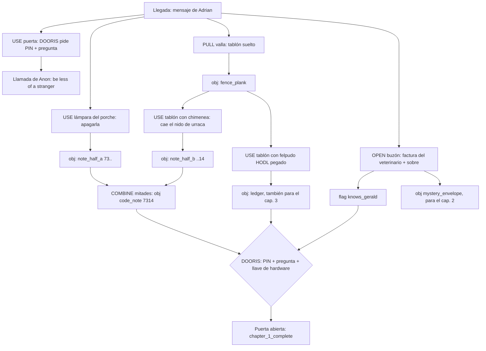
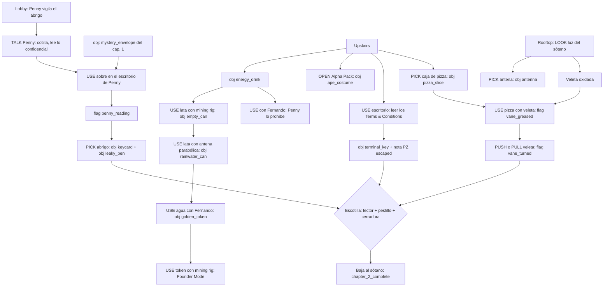
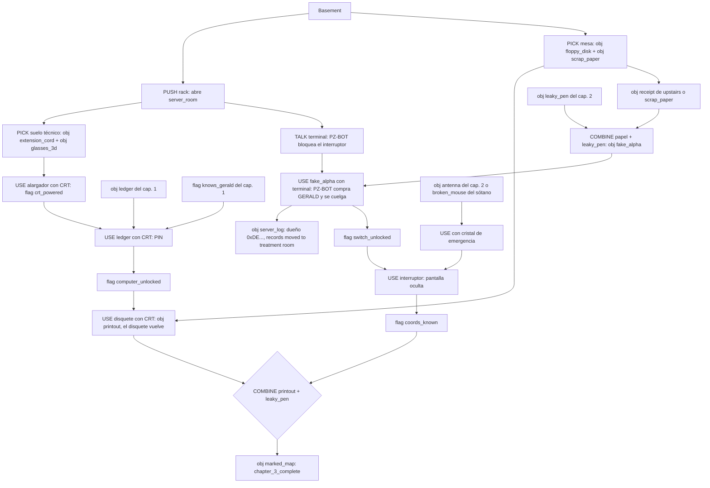
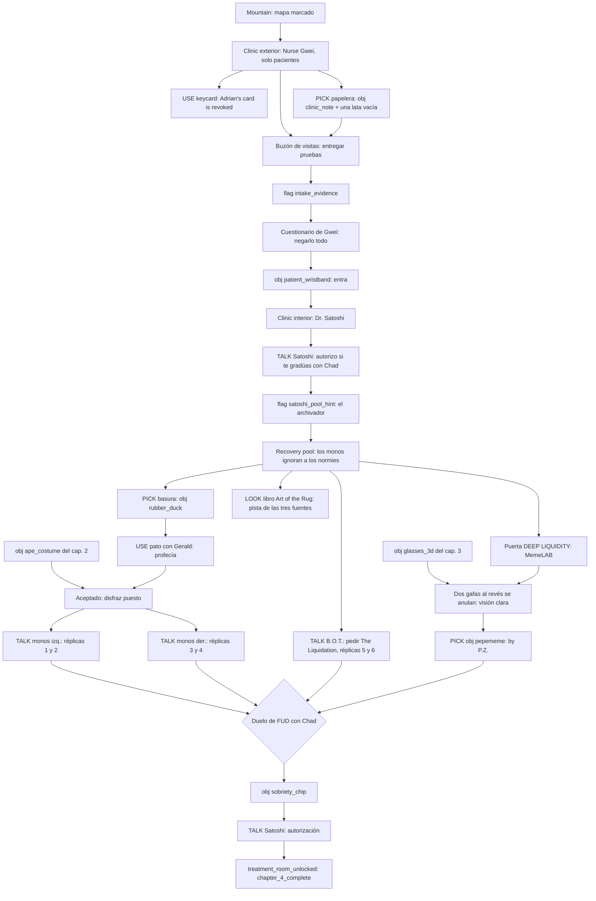
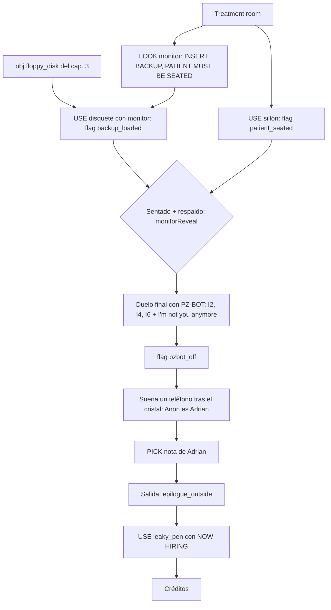

# ZEROadventure II — Biblia de diseño (A3.1)

> Fuente de verdad de historia, personajes, puzles, humor y Web3 del plan ADVENTURE_SCUMM.
> `STORY_PLAN.md` resume esto y las releases; si discrepan, manda esta biblia.
> Prosa en español; los textos del juego van en inglés, entre comillas, y son la propuesta para A3.3–A3.8.
> Base: `origin/main` = `64f4d63` (13 escenas, motor con los opcodes de `src/systems/ScriptEngine.ts`).

**Convenciones**

- **Hoy**: se implementa con los campos y opcodes que existen en `64f4d63`: `say`, `sayBrief`, `setFlag`,
  `addItem`, `removeItem`, `ifFlag`, `ifHasItem`, `ifVisited`, `ifWalletConnected`, `web3Require`,
  `fadeToScene`/`gotoScene`, `dialogue`, `titleCard`, `narrative`, `achievement`, `mintAchievement`,
  `monitorReveal`, `flicker`, `credits`, `setCostume`, `stop`; combos objeto→hotspot (`scene.combos`),
  objeto+objeto (`assets/config/global.json` `itemCombos`), elecciones con `flag`/`setFlag`/`gate`,
  `conditionalOverlays`, `showWhenFlag`/`hideWhenFlag`, `giveResponses`/`useResponses` (solo texto).
- **Planificado**: lo cubre un checkpoint ya en el plan: **A1.9** (onEnter de nodo con todos los opcodes),
  **A2.5** (respuestas de fallo por objeto/hotspot), **A2.6** (opciones gastadas en gris, nodo de retorno,
  opciones condicionadas a flags u objetos, NPC que reaccionan a objetos enseñados), **A2.9** (diario),
  **A2.10** (cinemáticas: cámara, actores, letterbox).
- **Requiere motor: …**: no existe ni está planificado. Cada caso sale como checkpoint en «Checkpoints
  derivados» y siempre hay una forma de hacerlo **hoy** aunque sea menos vistosa.
- **Ojo con A2.6**: hoy `ChoicePanel` pinta las opciones con condición no cumplida con candado y **con su
  texto**. Los puzles de diálogo de esta biblia (DOORIS, PIN del Ledger, duelo de FUD) necesitan que A2.6
  **oculte** esas opciones (derivado `A2.6a`). Mientras no exista, el texto de una opción condicionada nunca
  es la respuesta («[The name on the vet bill]», no «Gerald»).

---

## 1. Premisa y giro

### La contradicción que se resuelve

Hoy la narrativa de `outside` dice que el creador desaparecido **es** Patient Zero («They call the missing
person "Patient Zero"»), y `STORY_PLAN.md` guarda como giro final que **Patient Zero eres tú**. Las dos
cosas no pueden ser verdad. Decisión: **Adrian no es Patient Zero**. La intro nunca dice quién es Patient
Zero; solo que hay que encontrarlo.

### Premisa (lo que el jugador sabe al empezar)

Dex Malone, «detective on-chain» con cero casos resueltos, recibe en su wallet un mensaje programado desde
la wallet de Adrian, el creador del ecosistema ZERO, que lleva tres semanas desaparecido:

> "If you're reading this, I didn't make it back in time. Find Patient Zero. Bring them home.
> Everything in the lab is yours if you do. — A."

En los foros se dice que «Patient Zero» es un saboteador: un bot que compra y vende a las 3 AM con dinero
del ecosistema. Dex lee «everything in the lab is yours» y ya está en el coche. La intro (A3.2) solo
muestra eso: el mensaje, la recompensa y la casa. **No nombra a nadie como Patient Zero.**

### Giro (lo que el jugador descubre)

1. **Patient Zero es Dex.** Fue el primer paciente de la clínica (Block 0). El Dr. Satoshi le aplicó la
   terapia «Cold Storage»: pasar los recuerdos de degen a un disquete de respaldo («BACKUP — DO NOT LOSE»)
   para curar la adicción. Dex se escapó a mitad de terapia con un exploit del contrato de admisión (que
   había escrito él mismo) y se fue con media memoria: no recuerda nada de su vida de degen, pero le quedan
   los tics (ve gráficos de velas en todas partes).
2. **El «saboteador» es PZ-BOT**, el bot de trading de Dex, que sigue corriendo con su wallet en la sala de
   servidores del laboratorio. Adrian lo dejó encendido y aislado para que Dex lo encontrara.
3. **Adrian no desapareció: montó el rastro.** La terapia solo funciona si el paciente se encuentra a sí
   mismo («You can't be told. You have to find yourself.» — Dr. Satoshi). Cada puzle del laboratorio es una
   prueba de paciencia diseñada por Adrian, y la voz anónima que llama a Dex por teléfono («Anon») es él.
4. **Final**: Dex se ve en el monitor del treatment room (su historial real si conectó wallet; el ficticio
   de Dex si no), gana el último duelo contra PZ-BOT (su propia voz) y apaga el bot. Adrian aparece tras el
   cristal de observación. Epílogo: «NOW HIRING». Dex firma como builder.

### Pistas del giro repartidas (juego limpio, en orden)

| Cap. | Pista | Dónde |
|---|---|---|
| 1 | DOORIS: «Voice match: 87 %. Close. Suspiciously close. Still no.» | `outside.hs_keypad` |
| 1 | La nota del PIN acaba en «If you found both halves, you're patient enough. — A.» (Adrian esperaba a alguien concreto) | mitades de la nota |
| 2 | Penny: «Have we met? You have a very... refundable face.» | diálogo de Penny |
| 2 | El abrigo de Adrian le queda perfecto a Dex. «Same size. Lots of people are this size.» | `lobby.hs_coat` |
| 3 | PZ-BOT habla con la voz de Dex, acelerada | `server_room.hs_terminal` |
| 3 | La wallet propietaria de PZ-BOT empieza por `0xDE…`. «Could be anyone. Literally millions of people.» | `server_log` |
| 4 | La firma «Patient Zero — [REDACTED]» de la hoja de visitas tiene la letra de Dex | `clinic_exterior.hs_visitor_box` |
| 4 | En la foto de inauguración, la cara rayada lleva gafas 3D rojo-cian | `clinic_interior.hs_clinic_photo` |
| 4 | B.O.T.: «The usual?» la primera vez que Dex pide | `recovery_pool` |
| 4 | El Rare Pepe está firmado «Specimen #001 — by P.Z.» y es el arma para ganar a Chad | `memelab.hs_pepememe` |
| 5 | Revelación en el monitor | `treatment_room.hs_monitor` |

La recepción de una pista nunca es «¡soy yo!»: Dex siempre la racionaliza con una excusa graciosa. El
jugador lo ve venir antes que Dex, que es la gracia.

---

## 2. Protagonista

**Dex Malone** (sprite existente: pelo de punta, **gafas 3D rojo-cian**, camisa de cuadros roja, vaqueros,
zapatillas rojas — `assets/sprites/player/*`; disfraz de mono `Ape-*`).

| | |
|---|---|
| **Quién** | «On-chain detective». 4.000 seguidores, la mayoría bots. Cero casos resueltos («statistically, I'm due»). |
| **Objetivo declarado** | Encontrar a Patient Zero y cobrar «everything in the lab». |
| **Objetivo real** | Recuperar quién es y elegir no volver a ser ese. |
| **Defecto** | Impaciencia y «chart-brain»: ve velas, banderas alcistas y soportes en nubes, grietas y pizzas; cree que todo es una señal. Los chistes cripto **son su síntoma**, no la voz del guion. Los demás se lo señalan y va mejorando por capítulos. |
| **Rasgos** | Seguro de sí mismo sin motivo, curioso, cobarde con elegancia, generoso cuando nadie mira. Nunca se quita las gafas 3D: «They're prescription.» |
| **Voz** | `am_michael` 0.95 (como los 2.600 clips actuales). Frases cortas, remate al final, se corrige a sí mismo. |
| **Arco** | Cap. 1–2: todo le parece un chart. Cap. 3–4: se pilla a mitad de frase («That cloud looks like a bull fl— it's a cloud, Dex.»). Cap. 5–epílogo: ve un amanecer como un amanecer. |

**Muestras de voz** (textos del juego):

- "Dex Malone, on-chain detective. Zero cases solved. Which, statistically, means I'm due."
- "A reward? I'm listening. I'm also already walking."
- "That cloud looks like a bull flag. ...It's a cloud, Dex. It's just a cloud."
- "I don't have a problem. I have a strategy. They look similar from the outside."
- "Patience is a virtue. I've read about it. Skimmed, really."
- "A bird's nest. Magpies steal anything shiny. Finally, someone with my investment thesis."
- "Same size as me. Lots of people are this size. It's a very popular size."
- (epílogo) "A sunset. Pink, orange... and that's it. That's the whole sunset."

---

## 3. Reparto

### 3.1 Personajes existentes, reescritos

| Personaje | Recurso | Voz Kokoro (`speaker`) | Motivación | Voz / humor |
|---|---|---|---|---|
| **Penny**, la recepcionista (hoy «Receptionist») | `sprites/npcs/receptionist.png` + `_talk` (busto 37×37), `lobby.npc_receptionist` | `af_heart` 1.0 (`recep`; añadir regla `match` «penny» → `recep`) | Lleva tres semanas sola y sin cobrar («paid in vested tokens»). Adrian le dejó una orden: «nadie toca mis cosas salvo Patient Zero». Quiere conservar el trabajo y no ser la culpable. | Política de RRHH como arma, cotilla incurable («I don't read other people's mail. Unless it's marked confidential. Then it's practically my job.»), es RRHH, Seguridad y la terapeuta de la planta. Cuida a **Fernando**, la planta del lobby. |
| **Dr. Satoshi** («not THAT Satoshi») | `sprites/npcs/dr_satoshi.png` + `_talk`, `clinic_interior.npc_dr_satoshi` | `am_adam` 0.85 (`satoshi`) | Quiere terminar el tratamiento de su primer paciente y publicar el paper. Su secreto: mira el precio a escondidas (recae en cada capítulo). | Lenguaje de terapeuta en bucle («And how does that make you feel? Bullish? Write that down. No, YOU write it down.»). Serio, seco, nunca se ríe de sus chistes. |
| **B.O.T.** (Beverage Operations Terminal) | Robot pintado en el fondo de `recovery_pool` (`hs_robot_bartender`), sin sprite propio | `am_adam` 0.9 (`bot`) — conserva sus 26 clips | Antiguo algoritmo de alta frecuencia reconvertido en camarero; quiere propinas y sentirse útil. | Literal: explica sus propios chistes («That was a joke. I am contractually obligated to disclose jokes.»). Sabe todo lo que se habla en la barra: es la fuente de réplicas del duelo. |
| **Narrador** | Cinemáticas (`narrative`, A2.10) | `bm_george` 0.9 (`nar`) | — | Solo en aperturas y cierres de capítulo, máx. 3 líneas (ver §5). |
| **Gerald** (pato de goma gigante) | Pintado en el fondo de `recovery_pool` (`hs_rubber_duck`) | Sin voz (chirrido de goma, A4.4) | Ser venerado. | **Gag recurrente** (ver §5): el mejor amigo de Adrian es un pato de goma; aparece en una factura del veterinario (cap. 1), en el PIN del Ledger (cap. 3), en la alfa falsa (cap. 3) y flota en la piscina (cap. 4). |

### 3.2 Personajes nuevos (todos sin arte de pago)

| Personaje | Qué es | Recurso existente | Voz Kokoro (nueva `speaker` en `scripts/voices/voices.json`) | Motivación | Voz / humor |
|---|---|---|---|---|---|
| **DOORIS** | La cerradura inteligente de la casa de Adrian, paranoica y susurrante. Cap. 1. | `outside.hs_keypad` (ya existe) + `flicker` del overlay `lamp_empty` para «parpadear» al hablar; LED por overlay recortado con sharp (opcional) | `dooris`: **`af_nicole`** 1.0 (susurro tipo ASMR; voz Kokoro estándar). `match`: «dooris» | Proteger a Adrian «from people. Like you.» | Seguridad absurda, tres factores para una puerta, pasivo-agresiva y educadísima. «Hi. I'm DOORIS. I keep Adrian safe. From people. Like you.» |
| **Anon** (es Adrian) | Voz al teléfono de Dex. Llama en momentos clave y, a demanda, da pistas. | Sin sprite: `say` con `speaker: "Anon"`; en A2.9 el diario es el móvil de Dex | `anon`: **`am_onyx`** 0.9 (grave, distinta de Dex/Satoshi). `match`: «anon», «adrian» | Guiar a Dex sin decirle la verdad (la terapia lo exige). | Seco, pocas palabras, nunca responde preguntas directas. «The door won't open for strangers. Be less of a stranger.» *click* |
| **PZ-BOT** | El bot de trading de Dex, vivo en un servidor. Habla por la terminal. Cap. 3 y 5. | `server_room.hs_terminal` y `hs_server_rack_a`; en cap. 5 el monitor del treatment room | `pzbot`: **`am_michael` 1.25** — la MISMA voz que Dex, acelerada (pista del giro). `match`: «pz-bot» (antes que «b.o.t») | Seguir comprando. Siempre. Obedece solo a su dueño. | Mayúsculas, entusiasmo infinito, cero memoria: «HELLO, STRANGER. YOU SOUND LIKE MY OWNER. FLATTERING. BUY?» |
| **Nurse Gwei** | Enfermera de admisión de la clínica, solo por interfono. Cap. 4. | `clinic_exterior.hs_main_entrance` y `hs_security_camera` (la cámara es «sus ojos»); sin sprite | `gwei`: **`bf_emma`** 1.0 (británica, estricta; A3.3b la deja en 1.0). `match`: «gwei» | Admitir pacientes, jamás visitas. | Burocracia hospitalaria: «Visiting hours are never. Patient hours are always. Which are you?» Se cree todo lo que suena a negación: «Denial. Promising.» |
| **Chad** | El paciente «que ganó dinero» (B.O.T. ya lo menciona: «Hi, I'm Chad»). Rey de la terapia de grupo y rival del duelo de FUD. Cap. 4. | El mono del flotador de diamante pintado en `recovery_pool` (nuevo hotspot `hs_chad` sobre él). Mejor: overlay con `Ape-Idle-1.png` teñido de dorado con sharp + cadena dibujada por código | `chad`: **`am_puck`** 1.0 (enérgico; A3.3b la deja en 1.0). `match`: «chad» | Seguir siendo el alfa de la piscina; en el fondo tiene culpa del superviviente. | Bro motivacional: «I made money in a bear market, bro. I'm basically a war veteran.» |
| **Los monos de la piscina** | Coro de pacientes (izquierda y derecha). Enseñan réplicas para el duelo. | Pintados en el fondo (`hs_pool_group_left/right`) | `npc`: **`bm_lewis`** (británico): monos con acento de club inglés, gag de contraste | Seguir flotando sin mirar el portfolio (récord: 45 min). | «Paper hands, old chap. Frightfully paper.» |

Chad y la silueta de Adrian (cap. 5) se pueden hacer **hoy** como `conditionalOverlays` (PNG del tamaño del
fondo, generado con sharp a partir de los sprites del jugador: teñido dorado o negro). Con **requiere motor:
`NPCData.sprite` + `tint` + `flipX`** (reutilizar un sprite existente como NPC con tinte, ver A4.2a en
«Checkpoints derivados») serían NPC con hablar animado, pero no es imprescindible.

---

## 4. Capítulos

Principios aplicados en todos (Monkey Island):

- **2–4 hilos en paralelo** por capítulo; ningún capítulo es una cola de una sola puerta.
- **Objeto + objeto** (`itemCombos`) y **cadenas de intercambio** al menos una vez por capítulo.
- **Pistas justas**: cada solución se anuncia antes con un LOOK, una frase de NPC o una llamada de Anon. Nada
  de «examinar 3 veces» como única pista ni hotspots de 1 % del fondo.
- **Sin callejones sin salida**: ningún objeto necesario se gasta antes de su último uso; los objetos de
  «prueba» se devuelven; todas las escenas anteriores siguen accesibles.
- **Soluciones con gracia**: la solución tiene un chiste propio, y los intentos fallidos tentadores tienen
  respuesta específica (A2.5).
- **Duración**: 20–40 min por capítulo (cap. 1, 15–20; cap. 5 + epílogo, 20).
- **Objetos locales**: lo necesario en un capítulo se consigue en ese capítulo, o el capítulo anterior
  obliga a llevarlo (es parte de su cierre). Nada de cruzar medio juego a por un objeto opcional que se dejó
  atrás; si un objeto de antes se usa, hay una alternativa en la escena.

**Ritmo (para el jugador con prisa)**

- Algo que tocar en ≤ 30 s desde New Game; primer objeto en ≤ 2 min; la apertura cinemática (A3.2) ≤ 20 s y
  se puede saltar.
- 3–4 **hitos** por capítulo (un hilo resuelto): sonido de descubrimiento, logro visual y tic en el diario
  (A2.9). Ningún tramo de más de ~8 min sin un hito.
- Llamadas de Anon ≤ 3 líneas.

**Escalera de pistas (Anon)**

Cada puzle de las tablas tiene tres niveles que Anon da por teléfono cuando el jugador le llama (A2.9: el
diario es el móvil de Dex; «Call Anon» elige la pista según las flags): 1) dirección («The birds know more
than they let on.»), 2) objeto («Something long could reach that nest.»), 3) solución casi literal («Pull a
plank off the fence. Poke the nest.»). La pista por inactividad actual se queda como red de seguridad.

Leyenda de los diagramas: rectángulo = acción/puzle, rombo = puerta del capítulo, `obj:` = objeto.

### Capítulo 1 — «Breaking & Entering» (`outside` → entrada al `lobby`)

**Sinopsis.** Atardecer. Dex llega a la casa de Adrian. Le abre (o no) **DOORIS**, la cerradura, con
autenticación de **tres factores** («for a door»): PIN, pregunta de seguridad y llave de hardware. El PIN
está partido en dos mitades escondidas por Adrian; la respuesta está en el correo de Adrian; la llave de
hardware (el Ledger) está bajo un felpudo que no se deja levantar. Anon llama en el primer contacto con DOORIS (toque la puerta, el teclado o presente un factor). Final: DOORIS se rinde, la puerta se abre
y Penny mira desde el mostrador. 15–20 min. Hitos: PIN completo, respuesta encontrada, Ledger, puerta.

| # | Puzle | Objetos | Hotspots | Flags propuestas | Pista justa | Chiste de la solución | Motor |
|---|---|---|---|---|---|---|---|
| 1.1 | Lámpara caliente | `note_half_a` | `hs_porch_light` (USE apaga, PICK coge) | `porch_light_off`, `found_note_half_a` (sustituye a `found_code_note` como paso; `found_code_note` queda para la nota entera) | LOOK: «Something's wedged behind the bracket. The bulb's been on for three weeks. I'm not touching that.» PICK con luz: «Hot. Hot hot hot.» | Al apagarla las polillas vuelan a la ventana lateral: «They'll find another light. Everyone does.» | Hoy |
| 1.2 | Tablón | `fence_plank` | `hs_fence` (PULL) | `has_plank` | El texto actual de PULL ya dice «I pull a plank. It comes loose.»; LOOK de la valla lo anuncia. | «Now there's an exploit in the perimeter. I'm the exploit.» | Hoy |
| 1.3 | Nido de urraca | `note_half_b` | `hs_chimney` (combo `fence_plank`) | `nest_down`, `found_note_half_b` | LOOK chimenea: «Magpies nesting in the drainpipe, way too high to reach. They steal anything shiny.» PICK: «Too high. I'd need something long.» La nota está envuelta en papel de aluminio. | Dex: «Magpies steal anything shiny. Finally, someone with my investment thesis.» | Hoy |
| 1.4 | Nota entera | `note_half_a` + `note_half_b` → `code_note` | — (`itemCombos`) | `found_code_note`, `has_code` | Cada mitad dice que falta la otra («...the other half is with the birds. They never sell.»). | La nota completa: «7314. If you found both halves, you're patient enough. — A.» Dex: «Patient. Me. Ha.» | Hoy |
| 1.5 | Pregunta de seguridad | `vet_bill` y `mystery_envelope` (el mismo OPEN da los dos) | `hs_mailbox` | `found_vet_bill`, `knows_gerald`, `found_envelope` | DOORIS pregunta «the name of the owner's best friend». LOOK de la factura: «PAWS & CLAWS VET. Patient: GERALD. Species: rubber duck (?). Born: 3 Jan 2009. Diagnosis: perfect. Note: please stop bringing him in.» | Respuesta «[The name on the vet bill]». DOORIS: «Gerald. Correct. He's a very good boy. He's a duck.» Las opciones falsas («password123», «Satoshi», «Mom») tienen su burla. | Hecho en A3.3d: la opción buena lleva `when: item:vet_bill` (A2.6a: oculta sin la factura) y su texto no es la respuesta; `knows_gerald` queda puesta para el diario y el PIN del Ledger (cap. 3) |
| 1.6 | DOORIS | `code_note`, `ledger` (no se gastan) | `hs_keypad`, `hs_front_door` (combos con los dos objetos; USE/TALK y cada combo abren el árbol, que presenta a DOORIS la primera vez, hace la pregunta mientras no esté respondida, enumera lo que falta y abre la puerta cuando están los tres) | `dooris_met`, `dooris_pin_ok`, `dooris_key_ok`, `dooris_question_ok`, `door_unlocked`, `chapter_1_complete` | Primera vez: «Three-factor authentication: PIN, security question, hardware key.» y «Voice match: 87 %…». LOOK del teclado enumera los factores que faltan. Si se falla la pregunta, «Lockout: three seconds. I'm merciful.» y repite. Frases de DOORIS ≤ 15 palabras. | «Three-factor authentication complete. One factor was a duck.» | Hecho en A3.3d (combos objeto→hotspot + árbol `dooris_auth`; el gag «Remove your glasses for Face ID» / «They're prescription» es una opción del hub) |
| 1.7 | Felpudo HODL | `ledger` | `hs_doormat` (combo `fence_plank`) | `found_ledger` | DOORIS pide «a hardware key». LOOK felpudo: «HODL. Glued down. Something lumpy underneath.» PICK sin tablón: «It's glued down. It says HODL. It means it.» | «Adrian's hardware wallet. Under the doormat. The most secure place in crypto: the obvious one.» DOORIS al recibirlo: «Ledger detected. Please don't plug things into me without asking.» | Hoy |
| 1.8 | Anon | — | nodos del árbol `dooris_auth` tras la presentación de DOORIS (primer contacto, venga por la puerta, el teclado o un factor) | `anon_call_1` | — | «*bzzz* Unknown number. ...Hello?» — «A friend of Adrian. The door won't open for strangers. Be less of a stranger.» — «Click. He hung up.» | Hecho en A3.3d (nodo con `speaker: "Anon"`) |

**Bonus Web3**: graffiti «ZERO WAS HERE» tras los arbustos (ya existe) y trampilla VIP del felpudo (ver §7).

### Capítulo 2 — «The Receptionist» (`lobby`, `upstairs`, `rooftop`)

**Sinopsis.** Dentro, Penny custodia el abrigo de Adrian (con la keycard) y no deja tocar nada. Arriba, el
trading floor: un cajón con cerradura de «Terms & Conditions», una pizza fosilizada y una lata de bebida
energética. En la azotea, la veleta Bitcoin oxidada sostiene el pestillo de la escotilla de servicio que baja
al sótano, donde parpadea una luz. La escotilla tiene **tres cierres** («Adrian trusts nobody»), uno por
hilo: **lector** (keycard, Penny), **pestillo** (veleta) y **cerradura** (terminal_key del cajón, que vuelve
a hacer falta en el cap. 5). Opcional: la planta Fernando y el Golden Token. 30–35 min. Hitos: keycard,
veleta, cajón, escotilla.

| # | Puzle | Objetos | Hotspots | Flags | Pista justa | Chiste | Motor |
|---|---|---|---|---|---|---|---|
| 2.1 | Penny y el abrigo | `mystery_envelope` (no se gasta: Penny lo devuelve «resealed, badly»), `keycard`, `leaky_pen` | `hs_monitor_desk` (combo sobre), `hs_coat`, `npc_receptionist` | `penny_reading`, `found_keycard`, `has_keycard`, `has_leaky_pen` | LOOK abrigo: «Something card-shaped in the breast pocket.» PICK abrigo con Penny mirando (frase que todo jugador oye): «Touch that coat and I call HR. I AM HR. ...Unless something CONFIDENTIAL lands on my desk. Then I'm very busy. Hypothetically.» Su diálogo lo repite: «I don't read other people's mail. Unless it's marked confidential.» | Penny se enfrasca: «Oh. Oh no. Oh, he did NOT.» Dex coge la keycard y un boli de un exchange quebrado que aún gotea: «Mt. Gox. Still leaking after all these years.» | Hoy (combo objeto→hotspot del escritorio). Con A2.6 también GIVE a Penny |
| 2.2 | Veleta oxidada | `pizza_slice` (se gasta) | `upstairs.hs_pizza_box`, `rooftop.hs_weather_vane` | `has_pizza_slice`, `vane_greased`, `vane_turned` | LOOK veleta: «Rusted solid. It needs grease. A lot of grease.» LOOK pizza: «Two slices. Forty percent cheese, sixty percent industrial lubricant.» | «Adrian's diet finally contributes to the infrastructure.» | Hoy |
| 2.3 | Escotilla | `keycard`, `terminal_key` | `rooftop.hs_roof_access_panel` (combos con los dos objetos; LOOK enumera los cierres que faltan) | `hatch_reader_ok`, `hatch_lock_ok`, `basement_unlocked`, `chapter_2_complete` | LOOK: «Three locks: a card reader, a keyhole, and something mechanical underneath. Adrian trusts nobody.» | «Three locks. Adrian trusts nobody. Including, apparently, Adrian.» | Hoy |
| 2.4 | Terms & Conditions | `terminal_key` | `upstairs.hs_desk` (USE abre el árbol `tos_drawer`) | `tos_read_1..3`, `found_terminal_key`, `found_pz_note` | LOOK cajón: «Locked. The lock is a tiny screen: 'Accept the Terms to open'.» El LOOK de la escotilla ya dijo que falta una llave. | «Accept» sin leer: «By accepting you agree to give Adrian your left kidney.» y no abre. «Keep reading» ×3 llega a la página 38: «Congratulations: you are the first person ever to read this. Drawer unlocked.» | Hoy (árbol de diálogo con `setFlag`) |
| 2.5 | Antena | `antenna` | `rooftop.hs_antenna_array` | `has_antenna` | LOOK: «One antenna is loose.» | Se usa en el cap. 3 (cristal) y para el reloj (opcional). | Hoy (existe) |
| 2.6 | Disfraz de mono | `ape_costume` | `upstairs.hs_alphapack` | `found_ape_costume` | LOOK: «Something furry is poking out.» | Se usa en el cap. 4. | Hoy (existe) |
| 2.7 (opc.) | Fernando y el Golden Token | `energy_drink` → `empty_can` → `rainwater_can` → `golden_token` (la lata vuelve vacía; no hace falta después: la prueba de insomnio del cap. 4 tiene lata local) | `hs_plant`, `hs_computer`, `rooftop.hs_satellite_dish` | `plant_revived`, `has_empty_can`, `has_rainwater`, `founder_mode` | Penny al intentar la bebida: «NO stimulants. Fernando is in recovery. He only drinks rain.» LOOK parabólica: «A three-metre bowl of rainwater. The best-funded birdbath in the city.» | El rig se bebe la lata: «Its liquid cooling gurgles. I think it's been waiting for this.» | Hoy |
| 2.8 (opc.) | Reloj de lujo | `luxury_watch` | `hs_armchair` | `watch_retrieved` | Existe. | Existe. | Hoy |

**Bonus Web3**: rama VIP de Penny (trampilla del felpudo: pide keycard y terminal_key, ahorra solo la
veleta), póster de holders, panel TraitLab del rig con 1000 $ZERO, Founder Mode con stats reales (ver §7).
Nota para A3.4: el texto actual de `hs_paper_tray` dice que el recibo lleva «coordinates to a clinic»; se
cambia (las coordenadas son del cap. 3).

### Capítulo 3 — «Below the Surface» (`basement`, `server_room`)

**Sinopsis.** El sótano: un CRT sin corriente, un disquete «BACKUP — DO NOT LOSE» y, tras el rack, la sala
de servidores. Allí vive **PZ-BOT**, el «saboteador»: un bot que solo obedece a su dueño, habla con la voz de
Dex y tiene bloqueado por software el interruptor de emergencia («SHUTDOWN = MISSED OPPORTUNITIES»). Tres
hilos: **CRT** (corriente, PIN del Ledger, disquete → listado de pacientes y mapa sin marca), **PZ-BOT**
(engañarlo con una alfa falsa: se cuelga, suelta su log y libera el interruptor) y **cristal** (romperlo con la
antena). Con el interruptor accionado, una pantalla oculta da las coordenadas y Dex marca el mapa. 30–35 min.
Hitos: CRT encendido, PZ-BOT colgado, coordenadas, mapa.

| # | Puzle | Objetos | Hotspots | Flags | Pista justa | Chiste | Motor |
|---|---|---|---|---|---|---|---|
| 3.1 | Corriente del CRT | `extension_cord` (sale con las `glasses_3d` del cap. 4) | `server_room.hs_raised_floor` (PICK/OPEN), `basement.hs_main_computer` | `has_extension_cord`, `found_glasses_3d`, `crt_powered` | LOOK CRT: «Its plug dangles a metre short of the socket. Classic last-mile problem.» LOOK suelo técnico: «Under these tiles: more cables than a DeFi protocol has dependencies.» | Bajo las baldosas: «An orange extension cord, the true backbone of every startup. And 3D glasses. Reversed. Red on the right. Monsters. I'll take both.» Al enchufar: «It's alive. It smells like 1997.» | Hoy (sustituye a la bebida energética, que pasa al cap. 2) |
| 3.2 | PIN del Ledger | `ledger` | `hs_main_computer` → árbol `ledger_pin` | `computer_unlocked` | El Ledger: «PIN hint: my best friend's birthday. DDMM.» La factura de Gerald (cap. 1) dice «Born: 3 Jan 2009». | Opción «7314»: «That's the door, genius.» Opción «[Gerald's birthday, DDMM]» → «0301. Gerald was born on the genesis block. Of course he was.» | Hoy (opción con `flag: knows_gerald` y texto que no es la respuesta) |
| 3.3 | Disquete | `floppy_disk` (vuelve al inventario), `printout`, `scrap_paper` | `hs_left_desk`, `hs_main_computer` | `found_floppy`, `floppy_inserted`, `has_printout` | El CRT dice «INSERT BACKUP». | El listado de pacientes con diagnósticos; al final, «PATIENT ZERO — STATUS: ESCAPED». El mapa sale sin marca: «A map with no X. Very zen. Very useless.» | Hoy |
| 3.4 | PZ-BOT y la alfa falsa | papel (`receipt` de upstairs **o** `scrap_paper` de la mesa del sótano) + `leaky_pen` → `fake_alpha` (se gasta), `server_log` | `server_room.hs_terminal` | `met_pzbot`, `pzbot_crashed`, `switch_unlocked`, `found_server_log` | PZ-BOT: «I ONLY TALK TO MY OWNER. OR TO ALPHA. DO YOU HAVE ALPHA?» Dex: «I could write some. I need paper, a pen, and no principles. I have two of those.» | Dex escribe «BUY $GERALD. TRUST ME.» PZ-BOT: «GERALD. GERALD. ALL IN.» *crash* y vuelca su log: «Owner wallet: 0xDE…». Dex: «0xDE… could be anyone. Literally millions of people.» | Hoy |
| 3.5 | Interruptor de emergencia | `antenna` del cap. 2 **o** `broken_mouse` del sótano (alternativa local; no se gastan) | `hs_emergency_switch` | `emergency_glass_broken`, `emergency_switch_flipped`, `coords_known` | Con PZ-BOT vivo: «EMERGENCY SHUTOFF DISABLED BY PZ-BOT. SHUTDOWN = MISSED OPPORTUNITIES.» Cristal: «I need a tool — something heavy, or something I can swing.» Con el ratón: «I swing the mouse by its cable. Medieval IT support.» | Se apaga todo menos un rack: «PZ-BOT: RUNNING ON BATTERY. 4 %. STILL BULLISH.» (sigue vivo para el cap. 5; no hay callejón por el orden) | Hoy |
| 3.6 | Mapa marcado | `printout` + `leaky_pen` → `marked_map` | — (`itemCombos` con `ifFlag coords_known`) | `has_marked_map`, `chapter_3_complete` | Sin coordenadas: «Mark what? I don't know where X is yet.» | «X marks the spot. I've always wanted to say that. I've never had a spot.» | Hoy |
| 3.7 (opc.) | Chip quemado, pegatina del mono, secretos del floppy VIP | existentes | existentes | existentes | — | — | Hoy |

Puerta de la montaña: `outside.tr_mountain`, `mountain.tr_to_clinic` y `hs_winding_path` piden
`marked_map` o `chapter_3_complete` (hoy: `printout`).

### Capítulo 4 — «The Mountain Path» (`mountain`, `clinic_exterior`, `clinic_interior`, `recovery_pool`, `memelab`)

**Sinopsis.** La clínica solo admite pacientes. Dex tiene que **hacerse admitir**: convencer a Nurse Gwei por
el interfono con pruebas de sus «síntomas» y negando tenerlos. Dentro, el Dr. Satoshi solo autoriza el
treatment room a quien se gradúe en la terapia de grupo, que en la piscina de liquidez manda **Chad**. Para
ganarle en el **duelo de FUD** hay que aprender réplicas de los monos y de B.O.T. (un libro dice dónde), y traer del
MemeLAB la única prueba que Chad no puede rebatir. 35–40 min. Hitos: admitido, aceptado en la piscina,
Pepe, Chad vencido.

| # | Puzle | Objetos | Hotspots | Flags | Pista justa | Chiste | Motor |
|---|---|---|---|---|---|---|---|
| 4.1 | Keycard revocada | `keycard` | `clinic_exterior.hs_main_entrance` | — | — | Gwei: «Adrian's card has been revoked. Since the incident. We don't talk about the incident.» | Hoy |
| 4.2 | Pruebas de admisión | una lata (`empty_can` de la papelera o cualquiera del cap. 2: `energy_drink`, `rainwater_can`) para el insomnio y `clinic_note` («Day 47: still believing») para la pérdida; se escanean y se devuelven | `hs_visitor_box` (combos), `hs_trash_can` (PICK da la nota y, si Dex no lleva lata, una vacía) | `intake_insomnia`, `intake_loss`, `intake_evidence` (lo pone el segundo combo si ya está el primero) | Gwei: «Patients must submit proof of symptoms. Insomnia. Loss. And denial — I'll test that one myself.» | La lata: «Proof of insomnia: one empty can of BULL RUN, 500 mg. Accepted.» | Hoy |
| 4.3 | Cuestionario de negación | `patient_wristband` | `hs_main_entrance` → árbol `gwei_intake` (opción final con `flag: intake_evidence`) | `admitted`, `clinic_unlocked` | Gwei avisa de que «denial» la evalúa ella. | Respuesta honesta («Maybe I have a problem») suspende: «Too self-aware. Come back worse.» La correcta: «I can stop whenever I want. I just don't want to.» — «Textbook. Welcome home.» | Hoy |
| 4.4 | Satoshi pone la condición | — | `npc_dr_satoshi` | `satoshi_needs_chad`, `satoshi_pool_hint` | Satoshi: «Nobody enters the treatment room without graduating group therapy. Group meets downstairs. Chad runs it. Nobody beats Chad without listening to the others first.» | «And how does that make you feel? ...Write that down.» | Hoy |
| 4.5 | Que los monos te acepten (dos soluciones) | `ape_costume` **o** `rubber_duck` | `hs_pool_group_left/right`, `hs_trash_pile`, `hs_rubber_duck` | `ape_costume_worn` **o** `duck_reunion` → `pool_accepted` | Monos: «Not one of us, old chap.» Gerald: «You need at least a rubber duck offering to approach.» (existe) | El pato junto a Gerald: «The prophecy... two ducks.» Los monos se apartan con reverencia. | Hoy |
| 4.6 | Aprender réplicas | — | `hs_pool_group_left` (R1, R2), `hs_pool_group_right` (R3, R4), `hs_robot_bartender` (R5, R6 al pedir «The Liquidation»), `hs_brown_book` (pista) | `fud_r1` … `fud_r6` | Cada fuente es un mini-duelo que Dex pierde y en el que oye las dos réplicas buenas. El libro «The Art of the Rug», cap. 3: «Comebacks are learned at the shallow end, the deep end, and the bar.» El diario (A2.9) apunta las réplicas aprendidas. | Ver tabla del duelo. | Hoy (árboles de diálogo con `setFlag`) |
| 4.7 | MemeLAB | `glasses_3d`, `pepememe` | `memelab.*` (combos existentes) | `memelab_clear_vision`, `found_pepememe` | Dex ya lleva gafas 3D: «My glasses are prescription. This room needs a second opinion.» | «Two wrong glasses make a right. First time in my life.» El Pepe: «SPECIMEN #001 — by P.Z. Do not expose to normies.» | Hoy |
| 4.8 | **Duelo de FUD** con Chad | `pepememe` (no se gasta), `sobriety_chip` | `hs_chad` (nuevo, sobre el mono del flotador de diamante) → árbol `chad_fud` | `beat_chad`, `has_sobriety_chip`, `chad_losses_1`, `chad_losses_2` | Satoshi y B.O.T. («Chad has one weakness: he has never made anything.») A la segunda derrota, Chad dice qué fuente falta («Even the posh apes in the shallow end have better comebacks, bro.»). | Ver abajo. Premio: «A sobriety token. Worth nothing. That's the point.» | Hoy, salvo ocultar las réplicas no aprendidas: **A2.6a** (imprescindible) |
| 4.9 | Autorización | `sobriety_chip` | `npc_dr_satoshi` (opción con `flag: has_sobriety_chip`) | `treatment_room_unlocked`, `chapter_4_complete` | Chad: «Show the Doc. He collects these.» | Satoshi: «You beat Chad? Nobody beats Chad. Chad doesn't even beat Chad.» | Hoy la autorización; retirar la ficha y el logro desde el onEnter del nodo requieren A1.9 (mientras, el logro va en el primer USE de la puerta del tratamiento) |
| 4.10 (lore) | El sobre de Adrian | `mystery_envelope` | `npc_dr_satoshi` (opción con `flag: found_envelope`) | `envelope_opened` | — | «The original referral. Signed by Adrian. The patient's name is under a coffee stain.» (el café de Penny) | Hoy |

#### El duelo de FUD (puzle de diálogo tipo duelo de insultos)

Reglas: Chad lanza un FUD; Dex responde con una réplica aprendida. Acierto → siguiente ronda. Fallo → Chad
gana, se ríe, y se puede repetir al momento (sin coste). Chad usa siempre **I3, I1, I5** y remata con
**I7**; las otras tres (I2, I4, I6) las usará PZ-BOT en el capítulo 5, así que todas las réplicas sirven.

| # | FUD | Réplica | Dónde se aprende |
|---|---|---|---|
| I1 | "Your bags are so heavy, the lifeguard filed a complaint." | "At least mine float. Yours sank in a kiddie pool." | monos izq. |
| I2 | "I've seen better hands on a broken clock." | "A broken clock is right twice a day. You're on a streak of zero." | monos izq. |
| I3 | "You bought the top so hard, they named it after you." | "And you sold the bottom so often, they gave you a loyalty card." | monos der. |
| I4 | "Nobody in this pool has ever heard of you." | "Then today they'll hear you lose." | monos der. |
| I5 | "Your roadmap is a napkin with a frowny face on it." | "Still more detail than your exit plan." | B.O.T. |
| I6 | "I've been liquidated by better people than you." | "I can tell. They left the receipts floating in the pool." | B.O.T. |
| I7 | "Name ONE thing you've built that anyone still wants." | *[Show the Rare Pepe]* "This." — Chad: "...Specimen #001? By P.Z.? Bro. BRO." | MemeLAB |

Para ganar a Chad (I3, I1, I5) hacen falta R3, R1 y R5, que solo se aprenden visitando las tres fuentes; como
cada fuente enseña un par, quien gana a Chad tiene las seis réplicas que PZ-BOT pedirá en el capítulo 5.

Implementación: un solo árbol `chad_fud`; cada ronda es un nodo con **4 opciones** (la buena y 3 réplicas de
otros pares, siempre las mismas en esa ronda; móvil en vertical), cada una con su `flag: fud_rN`, más «Show him
the Rare Pepe» (`flag: found_pepememe`) en la última; acierto → nodo siguiente; fallo → nodo `lose` con `end`
y `setFlag` del contador de derrotas. Réplicas ≤ 12 palabras. El nodo `win` pone `beat_chad` y da
`sobriety_chip` en su onEnter (`setFlag` y `addItem` ya funcionan hoy). **Requiere A2.6a**: hoy las réplicas
no aprendidas saldrían con candado y su texto, y el puzle desaparece.

**Bonus Web3**: rama VIP de Satoshi (ver §7: salta una ronda del duelo, no el capítulo), lectura de stats en
el ordenador de recepción con la caja de floppies (existe).

### Capítulo 5 — «Patient Zero» (`treatment_room`) y epílogo (`epilogue_outside`)

**Sinopsis.** Un sillón, un monitor apagado y una ventana de observación rota. El monitor pide dos cosas: el
respaldo («RESTORE FROM COLD STORAGE: INSERT BACKUP») y que el paciente esté sentado. Al restaurar, el
monitor muestra el expediente: la wallet del jugador si está conectada; si no, la de Dex. PZ-BOT, desde el
monitor, intenta convencer a Dex de volver a operar: **duelo final** con su propia voz. Al ganar, Dex apaga el
bot. Suena un teléfono al otro lado del cristal: Anon es Adrian. Epílogo al amanecer. 20 min. Hitos:
revelación, PZ-BOT apagado, Adrian, créditos.

| # | Puzle | Objetos | Hotspots | Flags | Pista justa | Chiste | Motor |
|---|---|---|---|---|---|---|---|
| 5.1 | Respaldo | `floppy_disk` | `hs_monitor` | `backup_loaded` | LOOK monitor. | «BACKUP — DO NOT LOSE. I didn't. For once.» | Hoy |
| 5.2 | Consentimiento | — | `hs_chair` | `patient_seated` | El monitor lo pide; el sillón tiene correas: «Comfy. Restraints optional. Hopefully.» | Las correas se cierran solas: «Optional, they said.» | Hoy (sin animación de sentarse; con A2.10 actor sentado) |
| 5.3 | Revelación | — | `hs_monitor` | `monitor_revealed`, `patient_zero_revealed` | — | Con wallet: historial real (`monitorReveal`). Sin wallet: expediente de Dex con guiños (`02:14 BUY $GERALD`, `03:00 BUY THE DIP`). | Hoy (`monitorReveal`); el expediente ficticio cambia `buildPatientFileLines` (código, A3.7) |
| 5.4 | Duelo final | — | `hs_monitor` → árbol `pzbot_final` | `pzbot_off` | Las réplicas son las del cap. 4 que Chad no usó (R2, R4, R6: garantizadas, ver el duelo); la última (`"I'm not you anymore."`) la desbloquea la propia revelación. | PZ-BOT: «YOU USED TO BE FUN.» — Dex: «I used to be you.» *apagado* | Hoy |
| 5.5 | Adrian | — | `hs_observation_window` (TALK) | `met_adrian` | El teléfono suena tras el cristal. | Adrian: «You took your time.» — Dex: «I was being patient. Apparently that's my thing now.» | Hoy (silueta como `conditionalOverlay` con `flag: met_adrian`) |
| 5.6 | Nota y salida | `adrian_note` | `hs_adrian_note`, `hs_exit_door` | `found_adrian_note` | Existe. | Nota reescrita (abajo). | Hoy |
| E.1 | Epílogo | `leaky_pen` | `epilogue_outside.hs_now_hiring_sign` | `signed_up`, `game_complete` | LOOK cartel: «Apply within. Bring your own pen.» | «Mt. Gox pen. Still leaking. Still useful. There's hope for all of us.» | Hoy |

**Nota de Adrian** (sustituye a la actual; la versión según el perfil on-chain se mantiene como bonus §7):
"Dex. If you're reading this, the game worked. You were never a saboteur. You were a patient who walked out
too early. Everything you solved, you solved by waiting, reading, and asking. That's the cure. Also, Gerald
says hi. — A."

---

## 5. Guía de humor

### Reglas

1. **Tope de chistes cripto**: como máximo **2 por escena** en descripciones (LOOK) y **1 de cada 4
   líneas** en diálogos. El resto: humor de personaje, situación, slapstick, absurdo y callbacks.
2. **El chiste cripto es de Dex** (síntoma) **o de quien se ríe de él**. Nunca del narrador.
3. **Lista negra** (A3.8 las sustituye todas): «like my portfolio» (28 apariciones hoy), «gas fee(s)» como
   remate (13), «Not an NFT», «Decentralized/Decentralization X» (13), «Proof-of-X» (12), «X is the
   original Y». Una fórmula puede volver **una vez en todo el juego** si es un callback consciente.
4. **El remate al final** y en ≤ 20 palabras. Un LOOK no pasa de 2 frases.
5. **Sin muros de texto**: un nodo de diálogo ≤ 25 palabras; ≤ 3 `say` seguidos fuera de cinemáticas; el
   lore largo va detrás de una opción «Tell me more» que nadie está obligado a elegir. Los nodos actuales de
   Satoshi y B.O.T. (40–60 palabras) y los 4 `say` de `clinic_exterior.hs_posters` se recortan en A3.6.
6. **La sátira cripto es el tono del juego; lo que se va es la fórmula.** Se quedan (y se buscan más como
   estos) los chistes cripto de dentro, con personaje o con callback: el boli de Mt. Gox que aún gotea;
   «BUY $GERALD»; Gerald nacido en el genesis block; la ficha de sobriedad «worth nothing, that's the point»;
   los diagnósticos de la clínica («Chronic Airdrop Dependency», «Terminal FOMO»); B.O.T. ex-HFT; el
   «Proof of Stake required» del escáner; los pacientes famosos de la hoja de visitas; DOORIS pidiendo tres factores a
   un pato. Se va el remate genérico intercambiable («…like my portfolio») que valdría para cualquier objeto.
7. **Cada personaje tiene su motor de humor** (§3): Penny = burocracia y cotilleo; Satoshi = jerga de
   terapia; B.O.T. = literalidad; DOORIS = seguridad paranoica y amable; Gwei = trámite hospitalario; Chad =
   autoayuda bro; PZ-BOT = Dex sin frenos; Anon = silencio.
8. **Callbacks**: cada capítulo recupera al menos dos elementos de capítulos anteriores.

### Gags recurrentes

| Gag | Aparece en |
|---|---|
| **Gerald**, el pato de goma mejor amigo de Adrian | Cap. 1 factura del veterinario y pregunta de DOORIS; cap. 3 PIN y «BUY $GERALD»; cap. 4 Gerald en la piscina y profecía de los dos patos; cap. 5 «Gerald says hi»; epílogo |
| **«Voice match: 87 %»** | DOORIS (cap. 1), PZ-BOT (cap. 3: «VOICE MATCH 87 %. HI OWNER? NO?»), monitor (cap. 5: «100 %») |
| **El boli de Mt. Gox** que gotea | Sale del abrigo (cap. 2), escribe la alfa falsa y marca el mapa (cap. 3), firma el NOW HIRING (epílogo) |
| **Chart-brain de Dex** | Cada capítulo una vez menos; en el epílogo, el amanecer es solo un amanecer |
| **«They're prescription»** (gafas 3D) | Cap. 1 (DOORIS: «Remove your glasses for Face ID.» — «They're prescription.»), cap. 3, cap. 4 MemeLAB |
| **Penny es RRHH** | Cap. 2 en cada amenaza; cap. 5 llamada final: «HR has approved your hiring. I am HR.» |
| **Las polillas** | Cap. 1 (lámpara), cap. 2 (lámpara de la mesa: «The moths followed me.»), epílogo (vuelan al sol) |
| **Paciencia** | Todas las soluciones premian esperar, leer o preguntar; Dex lo nota y le molesta |

### Antes → después (frases reales de los `scene.json`)

| Escena · hotspot · verbo | Antes | Después |
|---|---|---|
| `outside.hs_trees` PICK | "A leaf. Already turning orange. Like my portfolio." | "A leaf. It's turning orange. ...I'm not going to say it. I'm working on that." |
| `outside.hs_fence` PICK | "I pull a loose splinter off. Ouch. Not worth the gas fees." | "I pull a splinter off. Ouch. Adrian's fence just bit me. Even the furniture here has trust issues." |
| `outside.hs_power_pole` PICK | "Not an NFT." | "I'd need a much bigger pocket. And a utility company that likes me." |
| `outside.hs_sunset_sky` PULL | "I try to pull the sunset back. Time only moves in one direction. Like my portfolio." | "I try to pull the sunset back. The sun ignores me. Professionally." |
| `outside.hs_sunset_sky` GIVE | "The sky doesn't accept offerings. Not even gas fees." | "I offer the sky a nod of respect. It sets anyway. Rude, but fair." |
| `outside.hs_path` USE | "Walking on it. Left, right. Decentralized movement." | "Left foot, right foot. I've got the hang of this." |
| `outside.hs_trees` USE | "I lean against a tree. Nature's proof-of-stake." | "I lean against a tree. The tree has more patience than me. Everyone does, apparently." |
| `mountain.hs_spring` PICK | "I fill an empty bottle with spring water. H2O — the original proof-of-work." | "I fill the bottle. Fresh mountain water. Fernando would weep." (callback a la planta) |
| `mountain` trigger sin mapa | "...I'm not hiking blind. My cardio is more bearish than my portfolio." | "I'm not hiking blind. Last time I followed a vague trail, I lost three weeks. ...Did I?" (pista del giro) |
| `clinic_interior.hs_waiting_chairs` GIVE | "The chairs have received enough. Mostly butts and bad news. Same as my portfolio." | "The chairs have received enough. Mostly butts and bad news." |
| `lobby.npc_receptionist` diálogo «experiments» | "...dreams into... well, mostly gas fees. But sometimes magic!" | "Turning pixels into tokens. Tokens into dreams. Dreams into my unpaid overtime." |
| `basement.hs_ceiling_pipes` LOOK | "...They drip occasionally. The basement's own liquidity pool." | "Rusty pipes. They drip in a rhythm. Drip. Drip. Buy. ...Dex, they're pipes." |
| `clinic_exterior.hs_graffiti_gwei` LOOK | "...The patients were tagging the clinic. Proof-of-vandalism." | "'Gwei' and 'Degen', spray-painted. Nurse Gwei must love that." |
| `epilogue_outside.hs_birds` LOOK | "Birds circling in the dawn sky. Free. No gas fees. No slippage. Just vibes..." | "Birds circling in the dawn. I don't see a chart in them. Huh. First time." (cierre del arco) |

Regla para A2.5/A3.8: cada sustitución mantiene la intención del verbo (lo que el jugador intentaba) y añade
personaje o callback; no se sustituye un chiste cripto por otro chiste cripto.

---

## 6. `memelab` y `recovery_pool`, y escenas nuevas

**Decisión: se quedan las dos, dentro del capítulo 4 y en la ruta principal.**

- **`recovery_pool` («The Liquidity Pool»)** = la terapia de grupo del Dr. Satoshi. Se llega por el
  archivador de `clinic_interior` cuando Satoshi da la pista (existe `satoshi_pool_hint`). Papel: hub del
  duelo de FUD (monos, B.O.T., libro, Chad, Gerald). Encaja con el giro: es donde los pacientes «aportan
  liquidez» y donde B.O.T. reconoce a Dex.
- **`memelab`** = el laboratorio de memes de los pacientes, tras la puerta «DEEP LIQUIDITY». Papel: el Rare
  Pepe firmado por P.Z. (arma final contra Chad y pista del giro). Se mantiene el efecto anaglifo
  (`cameraEffect`) y su solución con las gafas 3D, con el chiste de las dos gafas que se anulan.
- **Cambios**: el combo Pepe + B.O.T. (logro 20022) se queda como bonus; los 6 combos «gafas + hotspot» del
  MemeLAB se mantienen (cualquier objetivo vale: no hay pixel hunting).

**Escenas nuevas posibles con fondos existentes** (opcionales, ninguna en la ruta crítica):

| Escena | Fondo | Uso | Requiere |
|---|---|---|---|
| `outside_night` | `outside` oscurecido | Volver al laboratorio desde la montaña ya de noche; DOORIS saluda a Dex por su nombre después del cap. 5 | **Requiere motor: tinte o efecto de cámara por escena** (`render.tint` o un `cameraEffect` «night»); sin él, se usa `outside` tal cual |
| `lobby_epilogue` | `lobby` | Escena post-créditos: Dex en el mostrador con el abrigo de Adrian; Penny ascendida «Head of HR (still me)» | Hoy (escena nueva con el mismo fondo, NPC Penny reutilizado) |
| `mountain_dawn` | `mountain` | Bajada tras el epílogo si se quiere jugar después de los créditos | Requiere motor: tinte por escena (opcional) |

`frontdoor` (que citaba `STORY_PLAN.md`) **no existe y no se crea**: el capítulo 1 acaba al cruzar la puerta.

---

## 7. Web3 como bonus

**Regla de oro: nada de Web3 bloquea la ruta principal.** Ninguna puerta, objeto requerido, diálogo
necesario ni el final dependen de conectar wallet, tener NFT o tokens. Las puertas de capítulo son flags
locales (`chapter_N_complete`); los NFT de logro son recuerdos, no llaves. Un holder puede **ahorrarse un
paso como máximo por capítulo** y ver contenido extra; nunca saltarse un capítulo.

| Cap. | Condición | Qué da | Qué NO hace |
|---|---|---|---|
| 1 | AdrianZERO | Graffiti «ZERO WAS HERE» tras los arbustos (existe) | — |
| 1–2 | AdrianZERO (rama VIP de Penny) | Penny revela la trampilla del felpudo: atajo al sótano que ahorra la veleta y la pizza | La trampilla tiene el mismo lector y la misma cerradura que la escotilla: pide keycard y terminal_key. No da la antena (el cap. 3 la pide; desde el sótano se sube al lobby) |
| 2 | AdrianPunks / AdrianZERO | Pósters del lobby (existen; A3.10: y el logro `holder_wall`, también con el graffiti del cap. 1) | — |
| 2 | ≥ 1000 $ZERO | Panel TraitLab del mining rig (A3.10: dashboard real con saldo, AdrianZERO y traits; logro `holder_rig` y la nota del sysadmin con el PIN del Ledger, que en el cap. 3 ahorra saber el cumpleaños de Gerald) | No abre nada que no se pueda abrir sin él |
| 2 | Golden Token (en juego) | Founder Mode con stats reales del Diamond (A9.13: vistas públicas leídas de Base, no hace falta wallet: supply, máximo, quemado y staking de $ZERO y AdrianZERO acuñados; sin red, «—») | Nunca cifras de ejemplo con aspecto de reales |
| 2–5 | Caja de floppies (holder) | Secretos de los CRT (lobby, upstairs, basement, clinic, treatment room; existen) | — |
| 4 | AdrianZERO (rama VIP de Satoshi) | Hoy da `treatment_room_unlocked` y `chapter_4_complete` y se salta todo el capítulo: **se cambia** a «Chad te respeta: empiezas el duelo en la última ronda» | No autoriza directamente el treatment room |
| 5 | Wallet conectada | `monitorReveal` con el historial real: «Patient Zero eres TÚ, jugador» | Sin wallet, expediente ficticio de Dex: el giro funciona igual |
| 5 | Perfil on-chain | Posdata de la nota de Adrian según holdings (textos de `STORY_PLAN.md`) | — |
| 5 | ≥ cierta cantidad de $ZERO | Placa de fundador con tu wallet (`web3Visuals`, existe) | — |
| Todos | Wallet | `mintAchievement` de logros y coleccionables: opcional, en segundo plano, nunca bloquea (A1.1) | — |

**Cuándo se entera el jugador** (sin calzador):

- Al cerrar cada capítulo, el logro visual aparece siempre; con wallet, el toast ofrece el badge on-chain
  (`mintAchievement` en segundo plano). Sin wallet, una línea en el diario: «Badge available — connect a
  wallet to keep it (optional).»
- **Antes del capítulo 5**, un aviso no bloqueante: Satoshi al autorizar («The monitor reads whatever wallet
  you bring. Bring yours, if you dare.») y Anon en su llamada. El jugador decide antes de entrar.
- Los holders ven sus extras donde ocurren (póster, opción VIP con su etiqueta), nunca en un menú de ventas.

Cambios respecto a hoy: (1) `STORY_PLAN.md` decía que el treatment room exige wallet y que el NFT del
capítulo N es la puerta del N+1: se elimina; (2) la rama VIP de Satoshi deja de saltarse el capítulo y se
queda en «empezar el duelo en la última ronda»; (3) la trampilla VIP se mantiene como atajo de un paso y pide
keycard y terminal_key.

---

## 8. Arte necesario frente a disponible

El juego funciona sin nada de la columna «Arte pendiente». Rutas relativas a `assets/`.
`ASSET_GENERATION_PLAN.md` (PixelLab/SpriteCook) queda en suspenso por la decisión D2: lo de la columna
«Arte pendiente» alimenta el registro de A4.6 y solo se genera con el OK de Adrián.

| Elemento | ¿Existe? | Cómo se hace sin coste | Arte pendiente (especificación) |
|---|---|---|---|
| Dex andando/reposo | Sí: `sprites/player/Idle-*`, `Walk-*`, `Left/Right` | — | — |
| Dex de frente y de espaldas | Sí, sin usar: `Front-Left/Right`, `Back-Left/Right` | A4.1 | — |
| Dex sentado en el sillón (cap. 5) | No | Sin pose: Dex se queda junto al sillón y un overlay de correas cerradas (recortado del fondo y retocado con sharp, `flag: patient_seated`) cuenta que está sentado; con A2.10 (opcodes de actor) se puede ocultar al jugador durante la escena | 32×60 px, 2 frames (sentado, sentado hablando), paleta del sprite del jugador, `treatment_room` |
| Disfraz de mono | Sí: `Ape-*` | — | — |
| Penny | Sí: `npcs/receptionist.png` + `_talk` | A4.2 | Cuerpo entero 25×103, 4 frames idle + 2 talk |
| Dr. Satoshi | Sí: `npcs/dr_satoshi.png` + `_talk` | A4.2 | Cuerpo entero 25×103 |
| B.O.T. | Pintado en el fondo de `recovery_pool` | Brillo de LED por overlay recortado + `flicker` | Sprite 40×60, 3 frames (agitar coctelera) |
| Chad | Pintado en el fondo (mono del flotador) | Overlay `chad.png` a tamaño de fondo: `Ape-Idle-1.png` ×N con nearest, teñido dorado y cadena dibujada por código (sharp), `conditionalOverlays` | Sprite 25×103 propio, 4 frames idle + 2 talk, gafas de sol y cadena de oro |
| Adrian (silueta, cap. 5 y epílogo) | No | Overlay generado con sharp: `Idle-1.png` en negro con 70 % de opacidad tras el cristal de `treatment_room` | Sprite 25×103 idle + talk para el epílogo |
| DOORIS | Hotspot `hs_keypad` | LED: overlay recortado del teclado con sharp + `flicker` | — |
| Nurse Gwei | No | Solo voz por interfono; la cámara (`hs_security_camera`) parpadea con overlay + `flicker` | Silueta 37×37 tras el vidrio de la puerta |
| PZ-BOT | Terminal pintada | Solo voz y texto | **Requiere motor (opcional)**: texto sobre una pantalla de la escena |
| Iconos nuevos de inventario (64×64, `sprites/items/<id>.png`) | No | Por código (sharp): `note_half_a/b` = recortes de `code_note.png`; `vet_bill` = `receipt.png` teñido; `empty_can`/`rainwater_can` = `energy_drink.png` desaturado / teñido azul; `fake_alpha` = `receipt.png` + texto; `marked_map` = `printout.png` + X roja; `scrap_paper` = recorte de `printout.png`; `patient_wristband` = `keycard.png` teñido; `sobriety_chip` = `golden_token.png` en bronce; `fence_plank`, `pizza_slice`, `leaky_pen`, `extension_cord` = pixel art 64×64 dibujado en SVG por script y rasterizado con sharp | Versiones dibujadas a mano, 64×64, contorno negro de 1 px, paleta de los iconos actuales |
| Polillas, polvo, LEDs, niebla, nubes, luces, goteras, pájaros | Sí (A4.3): `ambient[]` de cada `scene.json`, dibujado por código sin assets (`src/systems/Ambient.ts`; ver `qa/README.md` § Animación ambiental) | — | — |
| Nido cayendo | No | Tween del icono `note_half_b` o solo texto | — |
| Pato chirriando, interfono, teléfono | Sí (A4.4): `duck_squeak`, `intercom_buzz`, `phone_ring`/`phone_pickup`, más pasos por superficie, puertas, interfaz y 9 bucles de ambiente, todo sintetizado en `scripts/audio/` | — | — |
| Variantes noche/amanecer | No | **Requiere motor**: tinte por escena | Fondos propios 3712×1152 |
| Fondos de las 13 escenas | Sí | — | — |

---

## Checkpoints derivados

Para que el orquestador los añada al estado. Formato: id · título · deps · zona. Todos actualizan
`qa/walkthrough.json` (ruta crítica) y `qa/sequence-breaks.json` (atajos con `attempt` y `expect`/`rejects`,
ver `qa/README.md`); las voces nuevas se generan con la etiqueta `voices` (A0.3); los objetos nuevos llevan
icono en `assets/sprites/items/` (por sharp, §8) y entrada en `PreloadScene` (si no, error (f) del linter).
Si una flag se renombra, migración en `src/systems/SaveMigration.ts`; si una flag vieja deja de tener sentido
(p. ej. `has_printout` como llave de la montaña), la partida a medias se respeta: la condición nueva acepta
también la vieja (`marked_map` **o** `chapter_3_complete`).

**Motor y sistemas (afinan A2.6 y A2.9; van antes que A3.3)**
- `A2.6a` Opciones de diálogo **ocultas** (no en gris) si su `flag`/objeto no se cumple, y condición negada
  (`notFlag`). Lo necesitan DOORIS, el PIN del Ledger y los dos duelos de FUD · deps: A2.6 · zona: ui.
- `A2.9a` Diario = móvil de Dex con «Call Anon»: escalera de 3 pistas por puzle elegida por flags (tabla
  de pistas en un JSON por capítulo), hitos con tic · deps: A2.9 · zona: ui.

**Capítulo 1 (A3.3)**
- `A3.3a` Premisa coherente en los textos: narrativa de `outside` (onEnter y `tr_game_opening`) e
  `introLines` de `ChapterManager` sin «el creador es Patient Zero»; mensaje de Adrian con la recompensa (A3.2
  lo convierte luego en cinemática) · zona: contenido.
- `A3.3b` Voces nuevas en `scripts/voices/voices.json`: `dooris` (af_nicole), `anon` (am_onyx; regla también
  para «adrian»), `gwei` (bf_emma), `chad` (am_puck), `pzbot` (am_michael 1.25; regla antes de «b.o.t»),
  regla «penny» → `recep`; renombrar la NPC a Penny · zona: contenido.
- `A3.3c` PIN partido: lámpara (apagar y coger), tablón de la valla, nido de urraca, combo de mitades; iconos
  `note_half_a/b`, `fence_plank` por sharp · zona: contenido.
- `A3.3d` DOORIS: árbol `dooris_auth` (PIN + pregunta, opciones falsas con burla), buzón con factura de
  Gerald y sobre en un solo OPEN, «voice match 87 %», primera llamada de Anon; felpudo pegado + tablón →
  Ledger · zona: contenido.
- `A3.3e` QA del cap. 1: walkthrough nuevo; atajos `puerta-sin-pregunta` (PIN y Ledger sin la factura),
  `puerta-sin-pin` (Gerald y Ledger sin `code_note`), `puerta-sin-llave` (PIN y Gerald sin Ledger),
  `nota-con-lampara-encendida`, `ledger-sin-tablon`; demo `a3-3-chapter1` (GIF del final del capítulo) · zona: ci.

**Capítulo 2 (A3.4)**
- `A3.4a` Penny reescrita (árbol con nodo central, RRHH, Fernando, «refundable face»); abrigo vigilado con la
  pista del sobre; sobre en el escritorio → keycard + `leaky_pen`; Penny devuelve el sobre · zona: contenido.
- `A3.4b` Escotilla de tres cierres (lector, pestillo, cerradura) y veleta oxidada con grasa de pizza; el
  capítulo acaba al bajar (no al mirar la luz) · zona: contenido.
- `A3.4c` Cajón de Terms & Conditions (árbol `tos_drawer`) → `terminal_key`; texto del recibo sin
  coordenadas · zona: contenido.
- `A3.4d` Cadena opcional de Fernando (Penny prohíbe la cafeína, rig, parabólica, Golden Token); trampilla
  VIP con keycard y terminal_key · zona: contenido.
- `A3.4e` QA del cap. 2: atajos `abrigo-con-penny-mirando`, `escotilla-sin-grasa`,
  `escotilla-sin-terminal-key`, `trampilla-vip-sin-keycard` (con wallet simulada si el runner lo permite; si
  no, test unitario del script), `planta-con-cafeina`; actualizar `sotano-sin-keycard` · zona: ci.

**Capítulo 3 (A3.5)**
- `A3.5a` CRT: alargador + gafas bajo el suelo técnico, PIN del Ledger (árbol `ledger_pin`), disquete que
  vuelve al inventario, `scrap_paper` en la mesa; iconos `extension_cord`, `scrap_paper` · zona: contenido.
- `A3.5b` PZ-BOT en la terminal: bloqueo del interruptor, alfa falsa (papel + boli), `server_log`, SAI
  («running on battery») · zona: contenido.
- `A3.5c` Interruptor con `switch_unlocked` y cristal; mapa marcado (printout + boli con `coords_known`);
  salidas de la montaña con `marked_map` o `chapter_3_complete` · zona: contenido.
- `A3.5d` QA del cap. 3: atajos `crt-sin-corriente`, `interruptor-sin-pzbot`, `mapa-sin-coordenadas`;
  actualizar `clinica-sin-printout`, `recepcion-clinica-sin-capitulo-3` y las dos de la montaña al nuevo
  objeto · zona: ci.

**Capítulo 4 (A3.6)**
- `A3.6a` Nurse Gwei: interfono, keycard revocada, pruebas en el buzón de visitas (lata local + nota),
  cuestionario de negación → `patient_wristband`; la hoja de visitas queda como lore con la letra de Dex ·
  zona: contenido.
- `A3.6b` Dr. Satoshi reescrito (≤ 25 palabras por nodo): condición de Chad, sobre de Adrian, autorización con
  la ficha, aviso de wallet antes del cap. 5; rama VIP → «última ronda» · zona: contenido.
- `A3.6c` Piscina: aceptación por disfraz o pato; fuentes de réplicas por pares (`fud_r1..6`); libro como
  pista · zona: contenido.
- `A3.6d` MemeLAB: gafas al revés que se anulan, Pepe «by P.Z.» · zona: contenido.
- `A3.6e` Duelo de FUD: `hs_chad`, árbol `chad_fud` (4 opciones por ronda), burla-pista a la segunda derrota,
  overlay de Chad por sharp, `sobriety_chip` · deps: A2.6a · zona: contenido · visual.
- `A3.6f` QA del cap. 4: atajos `clinica-sin-pruebas`, `piscina-sin-disfraz-ni-pato`, `chad-sin-pepe`,
  `tratamiento-sin-chad`; walkthrough hasta `chapter_4_complete` · zona: ci.

**Capítulo 5 y epílogo (A3.7)**
- `A3.7a` Monitor: respaldo + sillón → `monitorReveal`; expediente ficticio de Dex sin wallet en
  `buildPatientFileLines` · zona: contenido.
- `A3.7b` Duelo final con PZ-BOT (árbol `pzbot_final`, I2/I4/I6 + «I'm not you anymore») · deps: A2.6a ·
  zona: contenido.
- `A3.7c` Adrian: teléfono tras el cristal, silueta por overlay (sharp desde `Idle-1`), nota reescrita y
  posdata por perfil on-chain · zona: contenido · visual.
- `A3.7d` Epílogo: firma del NOW HIRING con el boli; créditos; escena post-créditos `lobby_epilogue`
  (opcional) · zona: contenido.
- `A3.7e` QA del cap. 5: atajos `monitor-sin-disquete`, `monitor-sin-sentarse`, `epilogo-sin-revelacion`;
  walkthrough completo hasta créditos · zona: ci.

**Motor opcional (no bloquea nada de lo anterior)**
- `A4.2a` Requiere motor: `NPCData.sprite` + `tint` + `flipX` para reutilizar sprites como NPC (Chad y la
  silueta de Adrian como NPC con hablar animado en vez de overlay) · deps: A4.2 · zona: motor.
- `A4.3a` Requiere motor: tinte por escena (`outside_night`, `mountain_dawn`) · deps: A4.3 · zona: motor.
