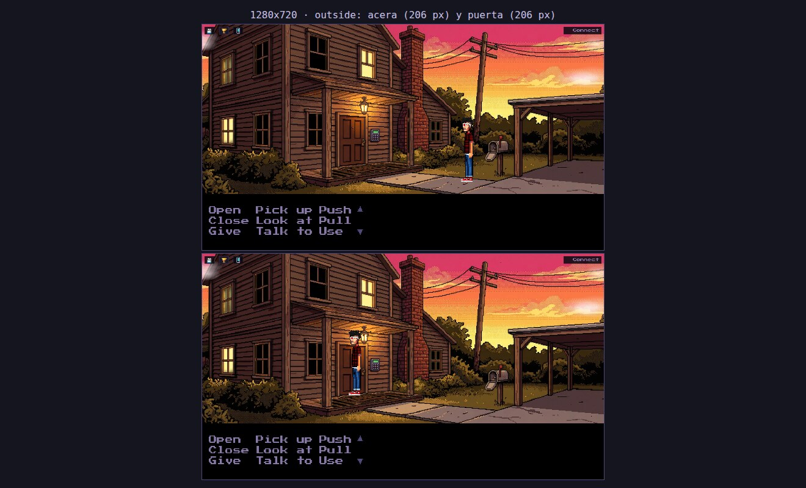
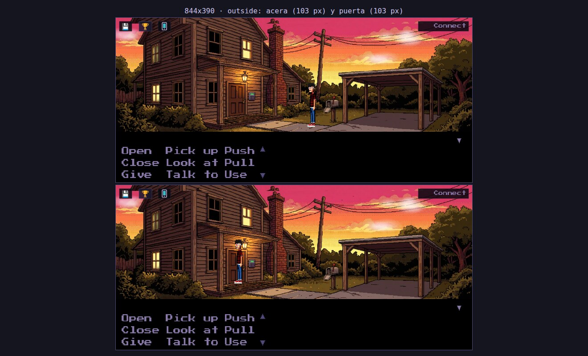

# A2.13 — Escala fija de Dex en outside y cambio de tamaño ≤ 25 % en el resto

Petición de Adrián (11-nov): el tamaño de Dex de A2.11 en la acera de `outside`, junto al buzón, está bien, pero al subir
al porche y llegar a la puerta encoge demasiado (capturas suyas: `notas/2026-11-11-outside-acera.png` y
`notas/2026-11-11-outside-puerta.png` del plan). En `outside` **no debe cambiar de tamaño en ningún momento**: se queda
con el de la acera. En el resto de escenas, el mismo criterio: si el fondo apenas tiene profundidad (fachada, porche,
interior poco hondo), escala fija. Solo cambia de tamaño donde el fondo se aleja de verdad, y aun así poco: **como mucho un
25 %** entre el punto más cercano y el más lejano.

## Tabla por escena

«Cerca» y «lejos» son el alto de Dex (en % del fondo, alto «del mundo») con los pies en el borde de abajo y en el de
arriba de `walkableAreas`. Los cálculos salen de `scripts/lib/proportion.mjs` (las mismas fórmulas que
`src/systems/PixelScale.ts`). Antes = `origin/main` 1387715.

| escena | modo | por qué | pixelScale antes → después | depthScale antes → después | cerca / lejos antes (% fondo) | cerca / lejos después | lejos/cerca antes → después |
|---|---|---|---|---|---|---|---|
| **outside** | **fija** | Adrián: la fachada y el porche apenas tienen profundidad; mide lo mismo en la acera que en la puerta | 4,5 → 4,5 | 83–92: 0,53–1 → **ninguno** | 40,23 / 21,32 | 40,23 / 40,23 | 0,53 → **1** |
| **clinic_exterior** | variable | fachada de frente con la acera casi plana, pero a la izquierda el camino sube al monte entre los árboles | 4,5 → **4,4** | 71,6–96: 0,35–1 → 71,6–96: **0,75–1** | 40,23 / 14,08 | 39,34 / 29,51 | 0,35 → **0,75** |
| **mountain** | variable | paisaje: el sendero se aleja de verdad hacia la casa del fondo | 4 → **3,4** | 59–86,5: 0,35–1 → 59–86,5: **0,75–1** | 35,76 / 12,60 | 30,40 / 22,83 | 0,35 → **0,75** |
| epilogue_outside | fija | plano general fijo, igual que outside (sin cambio de tamaño junto a la fachada) | 2 → 2 | — → — | 13,41 / 13,41 | igual | 1 → 1 |
| lobby | fija | interior de frente, suelo poco hondo | 7 → 7 | — → — | 62,59 | igual | 1 → 1 |
| upstairs | fija | interior, franja de suelo muy estrecha | 7 → 7 | — → — | 62,59 | igual | 1 → 1 |
| basement | fija | interior de frente, suelo poco hondo | 6,5 → 6,5 | — → — | 58,12 | igual | 1 → 1 |
| server_room | fija | interior, franja de suelo estrecha | 6,8 → 6,8 | — → — | 60,80 | igual | 1 → 1 |
| rooftop | fija | azotea de frente, suelo poco hondo | 5,5 → 5,5 | — → — | 49,18 | igual | 1 → 1 |
| clinic_interior | fija | recepción de frente, suelo poco hondo | 5,5 → 5,5 | — → — | 49,18 | igual | 1 → 1 |
| recovery_pool | fija | interior, franja de suelo muy estrecha | 5,5 → 5,5 | — → — | 49,18 | igual | 1 → 1 |
| memelab | fija | interior, franja de suelo estrecha | 6 → 6 | — → — | 53,65 | igual | 1 → 1 |
| treatment_room | fija | Dex no se ve (`hidePlayer`) | 5,5 → 5,5 | — → — | — | — | — |

Los interiores ya tenían escala fija desde A2.8 y A2.11. Solo había `depthScale` en outside, clinic_exterior y mountain.

### Qué extremo se conserva en las variables

- **outside**: el de la acera (factor 1 y pixelScale 4,5, sin cambios). Dex/puerta pasa de 0,97 a **1,75**: en el porche,
  Dex mide 1,75 veces la puerta de la casa (40,2 % del fondo contra 23 %). Ahí la regla nueva de Adrián manda sobre la de
  A2.11 («junto a la puerta, Dex ≈ 85-100 % de la puerta»). Queda como **excepción declarada** en
  `qa/proportion-refs.json` (campo `exception` de outside, con el motivo). El cociente se sigue calculando y se publica
  en la tabla de la demo de A2.11. La comprobación de la puerta sigue en pie en las demás escenas.
- **clinic_exterior**: se conserva **la puerta de la clínica**. Con 0,75–1 y pixelScale 4,5, Dex junto a la puerta
  (y 92, factor 0,96) mediría 1,04 veces la puerta, en el borde del 1,05. Con 4,4 queda en 1,02, y en la acera mide
  un 2 % menos que antes (39,3 % del fondo en lugar de 40,2 %).
- **mountain**: se conserva **el cartel de la clínica**, la referencia de la escena. Con 0,75–1 y pixelScale 4, Dex
  junto al cartel (y 71, factor 0,86) mediría 1,42 veces el cartel con sus postes (el rango razonado es 0,85–1,25).
  Con 3,4 queda en 1,21. Delante baja del 35,8 % al 30,4 % del fondo y al fondo del sendero sube del 12,6 % al 22,8 %.
  Es un plano general de paisaje, así que Dex queda algo más pequeño que en las fachadas.

Velocidad al andar (A2.12, `WalkMotion`): el avance se escala con el factor de profundidad, así que en outside ahora es
constante, y en clinic_exterior y mountain baja como mucho un 25 % al alejarse (antes, hasta un 65 %).

## Comprobaciones automáticas

- **Linter, regla l** (`scripts/lint-scenes.mjs`, «cambio de escala», ERROR):
  - un `depthScale` cuyo `min/max` de `scaleTop`/`scaleBottom` es menor que 0,75 (`MAX_DEPTH_CHANGE` = 0,25);
  - cualquier `depthScale` que cambie el tamaño en una escena de escala fija (`FIXED_SCALE_SCENES`: `outside`).

  Tests en `tests/lint-scenes.test.mjs`. También comprueban que el tope coincide con `scripts/lib/proportion.mjs`, que
  `FIXED_SCALE_SCENES` está declarada `fixed` en `qa/proportion-refs.json` y que las escenas del repo pasan.
- **`qa/proportion-refs.json`**: cada escena declara `scale` (`fixed` | `variable`) y su `scaleWhy`.
  `scripts/lib/proportion.mjs` añade `depthChange` y `scaleModeProblems`. En `evaluateScene`:
  - fija = sin depthScale que cambie el tamaño y el mismo alto en todas las posiciones medidas;
  - variable = depthScale con un cambio de tamaño ≤ 25 %.

  Lo usan la demo de A2.11 y `tests/proportion.test.mjs` (`npm run test:engine`). Uno de esos tests comprueba que
  outside es fija, sin depthScale, con pixelScale 4,5 y el mismo alto (40,23 %) en la acera (y 93) y en la puerta (y 83).
- **Demo** `scripts/demo-a2-13-fixed-scale.mjs`:
  - en outside, a 844x390 y a 1280x720: Dex en la acera junto al buzón (55, 93) anda hasta la puerta (34,5, 83,5) y
    vuelve. Mide su alto en pantalla en cada fotograma y falla si se aparta más de 1 px del de la acera o si el factor
    de profundidad no es 1;
  - en el resto de escenas: el alto en el punto más cercano y en el más lejano. Falla si lejos/cerca < 0,75, o si en una
    escena fija difieren más de 1 px.

  Capturas `outside-<viewport>-acera.png`, `outside-<viewport>-puerta.png` y las dos juntas en
  `outside-<viewport>-acera-y-puerta.png`; tabla en `fixed-scale.md`. Todo va en el artefacto `demo-gifs`.
- **Demo de A2.8**: en el porche de outside esperaba un factor de 0,5–0,65. Ahora exige que el factor sea 1 en todo
  el paseo y que Dex mida en el porche lo mismo que en la acera.

## Verificación

- En local (Node 20 del iMac, sin `--experimental-strip-types`): `node scripts/lint-scenes.mjs` da 0 errores y la regla l
  con 0 hallazgos. `node --test tests/lint-scenes.test.mjs` pasa 42 de 42. Los tests nuevos de `tests/proportion.test.mjs`
  se pasaron en una copia sin el import de `PixelScale.ts` (10 de 10; los dos que comparan con el `.ts` necesitan Node 22).
  `node scripts/lib/proportion.mjs table` da 0 problemas.
- CI de la PR (#67, commit 65ed155, run 43057771432):
  - build, lint (con `test:engine` entero), smoke y walkthrough: en verde;
  - demos de A2.11 y A2.8: OK. En A2.8, el factor es 1 en todo el paseo de outside y Dex mide lo mismo en la acera y en
    el porche (39,32 % del fondo en pantalla a 844x390 y 38,15 % a 1280x720). En A2.11 no sale ningún problema y
    outside queda con Dex/puerta 1,75 como excepción;
  - demo de A2.13: los altos quieto dan igual. En outside, la acera y la puerta miden 103 px las dos a 844x390, y 206 px
    las dos a 1280x720. El factor fue 1 en todos los fotogramas. Lejos/cerca: clinic_exterior 0,756 y mountain 0,756;
    el resto, 1.

    Aun así la demo falló. Comparaba el alto en pantalla de cada fotograma del paseo y ese alto va de 101 a 103 px
    (202-206 px a 1280x720), porque los fotogramas de la hoja de andar no miden todos lo mismo. La escala no cambia.
    Desde 8138a2d la demo compara la escala en cada fotograma y el alto solo con Dex quieto.

## Capturas (demo de A2.13 en CI): Dex en la acera, junto al buzón, y en la puerta

Arriba, en la acera; abajo, en la puerta. Mismo alto.

Las capturas por escena (`<escena>-cerca.png` / `<escena>-lejos.png`) y el GIF del paseo están en el artefacto
`demo-gifs` del CI.
