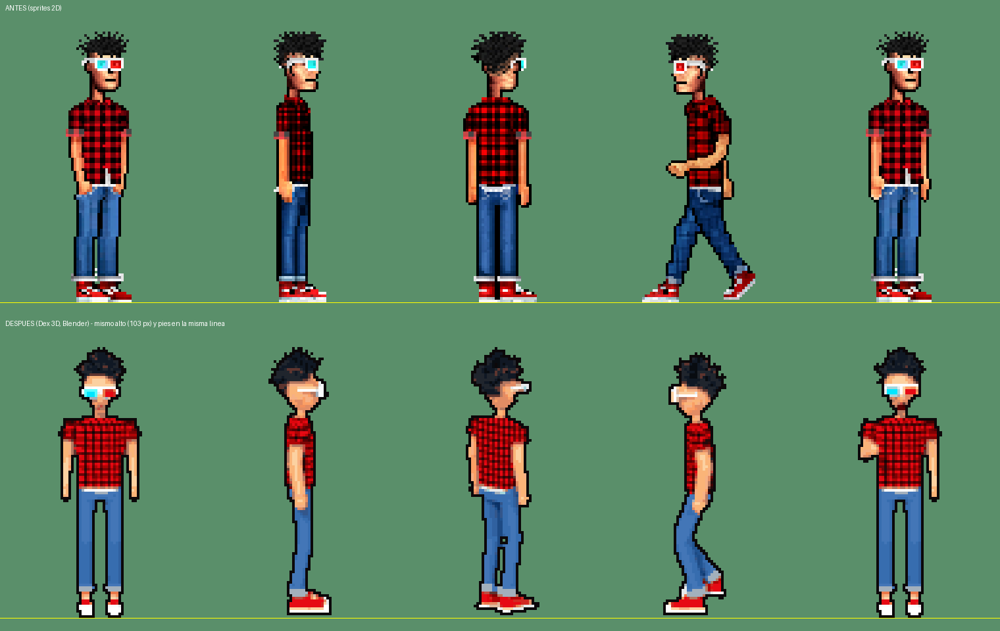
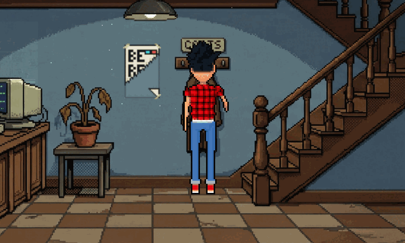
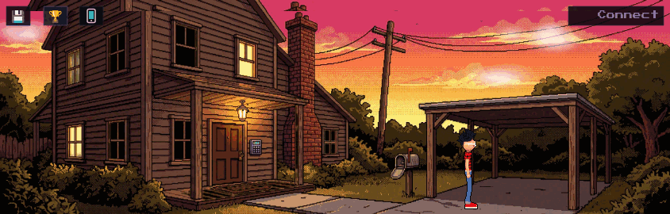

# A2.14 · Dex en 3D con rigging (sprites pre-renderizados con Blender)

Objetivo: Dex hecho en 3D con un rig de verdad y pasado a sprites de pixel art, como los clásicos: encaja con los
fondos, no pesa en el móvil (PNG de 72×108, ~3 KB) y da animaciones propias (andar en 4/8 direcciones con contacto
real de los pies, hablar, coger alto/medio/bajo, usar, empujar, tirar, dar, girarse) en vez de girar y balancear los
sprites de siempre.



## Enfoque

- **Todo por script** (`art/dex3d/`), headless, con el Blender oficial 4.2.3 LTS (tarball de blender.org en
  `~/opt/blender/blender-4.2.3-linux-x64/`; el render de prueba headless con Cycles en CPU funcionó a la primera).
  - `build_dex.py`: malla low-poly por piezas (tubos con anillos cada 2,5–3 cm en brazos y piernas, torso y pelvis
    por secciones, cabeza grande ×1,27 de aventura gráfica, pelo de 70 pinchos deterministas, gafas 3D blanca con
    lente cian a la derecha del personaje y roja a la izquierda, camisa de cuadros rojo/negro procedural sobre la
    posición de reposo —no «nada» al deformar—, vaqueros con el bajo vuelto, zapatillas rojas con suela blanca),
    materiales, armature y **pesos explícitos** (ver abajo). Sin pesos automáticos por calor.
  - `animate.py`: poses declarativas (cadera, columna, cabeza, mandíbula, IK de manos y pies, foot roll) y una acción
    por animación con clave en cada fotograma.
  - `render.py`: cámara ortográfica picada 12° (vista casi frontal de los fondos), llave cálida desde arriba a la
    izquierda + relleno frío + ambiente, Cycles CPU 16 muestras, fondo transparente, ×4 la resolución de arte.
    Calibra la escala para que Dex en reposo mida **103 px de arte** (el alto de siempre) y saca la zancada en metros
    de ahí.
  - `pixelize.py` (Python 3 + Pillow + numpy, fuera de Blender): media 4×4 → alfa binario (≥ 0,5) → color al más
    cercano de la **paleta de los sprites de Dex de siempre** (`palette.json`, median cut de `assets/sprites/player`
    sin el mono + lentes, piel y suela) → **contorno oscuro de 1 px** por dentro de la silueta → recorte con el
    punto de los pies fijo. Sin filtros: píxeles duros.
  - `dex.blend` (240 KB): el modelo con el rig y todas las acciones, para abrirlo en Blender.
- **Salida**: `assets/sprites/player3d/<anim>_<dir>_<i>.png` (72×108) + `dex3d.json` (animaciones, fotogramas, fps,
  bucle, origen). Dex ocupa las filas 0–102 (103 px de alto, igual que hoy) y los pies del reposo de frente están en
  la fila 102; las 5 filas de debajo son para el pie adelantado al andar hacia cámara. `Player.setTexture` pone el
  origen en `(0,5, 103/alto)` para cualquier textura más alta que 103: **el punto de los pies y el alto en pantalla
  quedan como hoy** (A2.11: `getWorldHeightPct` sigue usando 103).

## Rig (`build_dex.py`)

Huesos que deforman: `hips` → `spine` → `chest` → `neck` → `head` → `jaw` (boca); `shoulder.L/R` (clavícula, hijo de
`chest`) → `upper_arm` → `forearm` → `hand`; `thigh.L/R` (hijo de `hips`) → `shin` → `foot` → `toe`.
`root` (no deforma) es el padre de todo y gira a Dex para cada dirección.

Controles (no deforman, hijos de `root`):

| Control | Qué hace |
|---|---|
| `hand_ik.L/R` | objetivo del IK del brazo (muñeca) |
| `elbow_pole.L/R` | polo del codo (detrás del brazo: el codo dobla hacia atrás) |
| `foot_ik.L/R` | pie entero (talón → punta, en el suelo); girarlo sobre el talón = puntera arriba al pisar |
| `foot_roll.L/R` | hijo de `foot_ik`, pivote en la bola del pie: levanta el talón (despegue, puntillas) |
| `ankle_tgt.L/R` | hijo de `foot_roll`, en el tobillo: objetivo del IK de la pierna |
| `knee_pole.L/R` | polo de la rodilla (delante: la rodilla dobla hacia delante) |

Restricciones: IK en `forearm.*` (objetivo `hand_ik`, polo `elbow_pole`, cadena 2, `lock_ik_y`) e IK en `shin.*`
(objetivo `ankle_tgt`, polo `knee_pole`, cadena 2, `lock_ik_y` + `lock_ik_z`: la rodilla solo dobla en su plano);
`pole_angle` calculado por script a partir de la geometría (sin giros en reposo). `foot.*` con Damped Track a la
bola (`foot_roll`) y `toe.*` con Copy Rotation de `foot_ik` (la puntera queda plana al levantar el talón). Rodillas
y codos llevan una flexión mínima en reposo para que el IK sepa hacia dónde doblar.

Pesos: el de cada vértice se calcula proyectándolo sobre la cadena de huesos de su pieza, con mezcla smoothstep de
±4,5 cm en cada articulación (codo, rodilla, tobillo/bola, cuello ±2,5 cm, columna ±5 cm); el hombro mezcla brazo,
clavícula y pecho en los primeros 7 cm; las esquinas del torso mezclan con la clavícula; el arranque del muslo, con
la cadera; la cabeza, el pelo, las gafas, la nariz y las orejas van 100 % a `head` y la boca a `jaw`.

## Animaciones

| Animación | Direcciones | Fotogramas | fps | En el juego |
|---|---|---|---|---|
| idle (respira) | 8 | 4 | 3 | `player_idle1..4` (de frente); los fotogramas 0 de las 8 direcciones son las poses quietas de perfil y de espaldas (girarse) |
| walk | 8 | 8 | 14,8 (67,5 ms) | 4 direcciones (`player3d_walk_<down/up/left/right>_<i>`); las diagonales están renderizadas, sin usar |
| talk (gesticula: palma arriba, señala, cabeza que ladea) | 5 (de frente, perfiles, diagonales de frente) | 8 | 10 | de frente y de perfil |
| pick_low / pick_mid / pick_high | 4 | 5 | 15,6 (en los 320 ms de GESTURE_MS) | coger según la altura del objeto: < 0,3 del alto de Dex bajo, > 0,8 alto |
| use / push / pull / give | 4 | 5 | 15,6 | USE/OPEN/CLOSE → use, PUSH, PULL, GIVE |
| shrug («no puedo») | 3 (de frente y perfiles) | 7 | 10 (700 ms) | con cada respuesta de fallo (`FailResponses.onFail` → `Player.shrug()`), a la vez que el texto |
| idle_scratch / idle_glasses / idle_rock | 1 (de frente) | 10 | 9 | manías de reposo (tics de A4.1): rascarse la cabeza, subirse las gafas, balancearse con las manos a la espalda |
| idle_yawn / idle_tap | 1 (de frente) | 12 | 9 | bostezar estirándose; brazos cruzados con golpecitos del pie |

GIF por animación (×3): [walk](A2.14/walk.gif) · [idle](A2.14/idle.gif) · [talk](A2.14/talk.gif) ·
[pick_low](A2.14/pick_low.gif) · [pick_mid](A2.14/pick_mid.gif) · [pick_high](A2.14/pick_high.gif) ·
[use](A2.14/use.gif) · [push](A2.14/push.gif) · [pull](A2.14/pull.gif) · [give](A2.14/give.gif).
Modelo en 8 vistas + pose T: [vistas-modelo.png](A2.14/vistas-modelo.png).

### Zancada frente a los 74 px/s

WalkMotion mueve a Dex a 74 px de arte/s (× speed/140, y el reloj de la animación va con el mismo factor) y
Footsteps da un paso cada 20 px. El ciclo de andar se anima **en el sitio**: el pie apoyado retrocede a velocidad
constante = 2 zancadas / ciclo. Con zancada = 20 px de arte (0,374 m con la escala calibrada, 1 px = 1,87 cm) y ciclo
= 8 × 67,5 ms = 540 ms, el pie apoyado retrocede 74,07 px/s mientras el juego avanza 74: en pantalla queda quieto
sobre el suelo (deriva < 0,1 %). Apoyo del 60 % del ciclo (doble apoyo real), talón que pisa con la puntera arriba,
despegue sobre la bola (foot roll 32°), cadera que baja en el doble apoyo, brazos en contrafase. El test
`A2.14: andar 3D…` de `tests/player-anim.test.mjs` lo comprueba.

## Gracia (A2.14 bis: «con gracia, a lo Guybrush pero con el diseño de Dex»)

Se toma la actitud de Monkey Island (andar suelto, manías, gestos exagerados), sin copiar poses. Todo en
`art/dex3d/animate.py`; el rig y el modelo no cambian.

- **Andar** (`walk_pose`): rebote de cadera (−5,8 ± 3 cm, baja justo después del contacto y sube en el paso),
  **squash & stretch** de la columna (±3 %: encoge en el contacto, estira en el paso; escala del hueso `spine` con
  volumen constante), tronco adelantado desde la cadera con el pecho echado atrás (desgarbado) y balanceo lateral,
  pecho en contra de la cadera (±15° frente a ±9°), **overlap**: cabeza, pecho y brazos llegan tarde (desfases de
  0,35–2 rad), hombro que sube con el brazo que va delante, brazos de ±34° con el codo suelto (dobla más delante) y
  muñeca que «flamea» con retraso, rodilla alta (pie a 11,5 cm) y talón que planta con la puntera a 26°, despegue
  sobre la bola a 40°. Intocable y sin cambios: 8 fotogramas, 540 ms, zancada de 20 px, apoyo del 60 % con el pie
  que retrocede a velocidad constante (test `A2.14: andar 3D…`), pies en la misma línea.
- **Manías de reposo** (nuevas, de frente): anticipación (se encoge o baja antes), acción que se pasa un poco y vuelta
  con rebote. Integración: `IdleTicker` (A4.1) elige con Dex 3D de frente una manía (75 %) distinta de la anterior o
  mirar a un lado; primero a los 6 s y luego cada 3–6 s, semilla fija con `?qa=1`; se cortan al instante al andar,
  hablar o hacer un gesto. QA: `state().anim.idleTick === 'mania'` y `state().anim.mania` = cuál.
- **Hablar** (`talk_pose`): 8 fotogramas con poses propias: la derecha ofrece la palma (0–3) y la izquierda señala
  (4–6), cabeza que ladea, cabecea y gira a destiempo de las manos, hombros que acompañan. Sin cejas (el rig no las
  tiene); la boca es la mandíbula de siempre.
- **Gestos** (`GESTURE_ENV`): los 5 fotogramas pasan de `sin` a anticipación (−0,25: mano atrás, cadera abajo, cuerpo
  hacia atrás, squash), estirón que se pasa (1,15: stretch, hombro que se va, cabeza que acompaña), rebote (0,9) y
  vuelta (0,3). Mismos 320 ms.
- **Encogerse de hombros** (`shrug_pose`, nueva): anticipación hacia abajo, hombros arriba (24°) con el cuello
  hundido, palmas fuera, cabeza ladeada y boca torcida, y vuelta. `QaApi`: `state().anim.gestureAnim === 'shrug'`.

GIF de revisión ×4 (no van al repo; se rehacen con `/var/tmp/adv-dex3d-gracia/review.py <raw> <pix> <gifs>`): ver el
informe de la PR.

## Integración

- `PreloadScene`: las claves de siempre (`player_idle*`, `player_left/right`, `player_front_*`, `player_back_*`,
  `player_walk_*`) apuntan a fotogramas 3D; nuevas `player3d_<anim>_<dir>_<i>` (andar 4 × 8, hablar 3 × 8, 7 gestos ×
  4 × 5). El mono (`Ape-*`) y el tráiler (`TrailerScene` carga los PNG viejos) no se tocan.
- `PlayerAnim`: `walkPose`, `talkPose` y `gesturePose` usan los fotogramas 3D si existen (giro 0, sin elevación ni
  balanceo); si no (mono, tráiler), lo de siempre. Nuevas `DEX3D`, `DEX_ART_HEIGHT`, `WALK3D_*`, `TALK3D_*`,
  `GESTURE3D_FRAMES`, `GESTURES3D`, `facingDir3d`, `gestureAnimFor`.
- `Player`: origen en los pies para texturas de más de 103 de alto; `gesture(aim, anim?)`.
- `GameScene.startGesture`: elige el gesto por verbo y altura del objetivo.
- `SceneTextures`: `player3d_*` cuenta como «characters» en el informe de memoria (A5.1). GPU: ~200 texturas de
  72×108 ≈ 6 MB (antes ~26 pequeñas); no entra en el tope de arte de escena del smoke.
- Demos: `scripts/demo-a4-1-player-anim.mjs` al día (texturas 3D, sin balanceo ni cabeceo ni puntillas para Dex; el
  mono, igual) y nueva `scripts/demo-a2-14-dex3d.mjs` (outside y lobby: andar en 4 direcciones con su ciclo, hablar,
  los 7 gestos, alto constante).

En el juego (capturas del CI de la demo): 


Local: `npm run test:engine` 311/311 verde (Node 22.12); `npx tsc --noEmit` sin errores. Las demos no se han lanzado
en local (sin Chromium de Puppeteer en el iMac): las graba el CI.

## Cómo regenerar

```sh
B=~/opt/blender/blender-4.2.3-linux-x64/blender
turno-pesado -n ADVENTURE_SCUMM -- $B -b -P art/dex3d/render.py -- --out /var/tmp/adv-dex3d/views --views   # modelo: 8 vistas + pose T
turno-pesado -n ADVENTURE_SCUMM -- $B -b -P art/dex3d/render.py -- --out /var/tmp/adv-dex3d/raw --save-blend art/dex3d/dex.blend
python3 art/dex3d/pixelize.py --raw /var/tmp/adv-dex3d/raw --out assets/sprites/player3d --contact /var/tmp/adv-dex3d/contact.png
```

`--only walk,talk` renderiza solo esas. Todo el render son ~280 fotogramas en 1,5–6 min de CPU según la carga.
`pixelize.py` avisa de los píxeles que se salen del recorte (hoy solo 1–2 px en algunos gestos de espaldas).
Para cambiar la paleta, borrar `art/dex3d/palette.json` (se rehace con los sprites de `assets/sprites/player`).

## Qué queda

Revisión del orquestador (5 puntos de calidad del modelo y del pixelado), estado tras la segunda pasada:

1. **Contorno oscuro de 1 px**: hecho en `pixelize.py` con 8 vecinos (antes 4: quedaban píxeles claros en diagonal en
   zapatillas, brazos y gafas). Hecho.
2. **Cabeza**: más pequeña y estrecha (×1,08 en vez de ×1,27, 0,82 de ancho), cuello visible, barbilla y mandíbula
   adelantadas, nariz más larga, orejas, montura blanca gruesa y lentes con grosor y lateral de color. Parcial: de
   frente aún no se leen nariz ni boca y de perfil la lente se ve como raya blanca (el lateral de la lente queda
   tapado por la patilla). Pendiente: boca más adelantada (`mouth` y `MOUTH_C` en y −0,128), lateral de la lente
   fuera de la patilla (x ±0,128) y 1–2 px de cara pintados en el postproceso si hace falta.
3. **Cuerpo**: hombros más anchos (0,40 m), camisa hasta la cadera con goma blanca, mangas cortas con puño rojo
   oscuro, brazos de 3–4 px con manos visibles, zapatillas con puntera blanca y cordones. Parcial: de frente la
   puntera blanca ocupa demasiado (las zapatillas se leen blancas; bajarla a 2 cm de alto solo en la punta) y los
   vaqueros tienen 2 tonos, sin costuras.
4. **Pelo**: dos tonos (casi negro + gris oscuro en las caras que miran arriba), 120 mechones más finos. Hecho; se
   podría afinar más la silueta (más mechones sueltos, menos masa).
5. **Cuadros**: celda de 5 cm (≈ 3 px) y rojo más vivo con negro casi puro. Hecho.

Además:
- Diagonales (andar e idle en 8 direcciones ya renderizados) sin usar: PlayerAnim decide en 4 (`moveDir`).
- Hablar de espaldas: sin fotogramas (vuelve al cabeceo de siempre con la pose de espaldas).
- Los gestos de frente usan siempre la mano derecha de Dex (izquierda de la pantalla) aunque el objetivo esté al
  otro lado; se podría espejar o renderizar con la otra mano.
- Tráiler (`TrailerScene`) con los sprites viejos; disfraz de mono sin 3D (fuera de alcance).
- Un atlas por animación en vez de ~280 PNG sueltos (menos peticiones al cargar por primera vez).
- CI: la demo `a2-14-dex3d` falló en la primera pasada por tramos bajo el panel de verbos (corregido en 8f55ee1); el
  resultado de la última pasada está en la PR.
