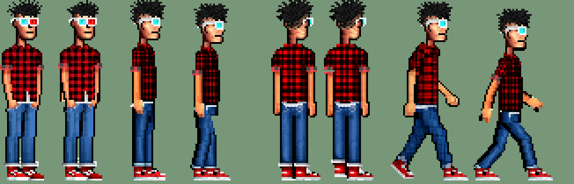

# A2.15 — Rig 2D del sprite actual de Dex

Plan B tras descartar el Dex 3D (A2.14): se anima con huesos en 2D **el mismo sprite** que ya había
(`assets/sprites/player`, ~25×103 px). Nada de arte nuevo ni APIs: un script local (Python + PIL + numpy).

(izquierda de cada par: PNG original; derecha: fotograma del rig en la misma pose — idle de frente, perfil, espalda, andar)

## Enfoque: pre-render a fotogramas (no contenedor de piezas en Phaser)

- A 25×103 px y escala ×2/×3 (A2.8), girar piezas en tiempo real en Phaser remuestrea a resolución de pantalla:
  píxeles a medio camino, bordes que «hierven» al girar y escalas que dejan de ser enteras. Pre-renderizado, cada
  fotograma es pixel art a ×1 con la paleta exacta del original y el juego sigue usando texturas sueltas como antes
  (mismo origen en los pies, misma escala entera, mismo `state().anim`).
- `art/dex2d/build.py` gira cada pieza sobre su pivote con **vecino más cercano por mapeo inverso** (cada píxel de
  destino copia exactamente un píxel de origen) y compone a ×1. El cuerpo y la cabeza solo se **trasladan** (píxeles
  enteros: el cuadro de la camisa y la cara no se deforman nunca); solo giran brazos, piernas y zapatos. Al final
  quita píxeles sueltos y **comprueba la paleta**: colores de salida ⊆ colores de los PNG originales → **0 fuera**.
  La única «pintura» nueva es el contorno oscuro de los brazos de frente, con el negro del propio contorno del sprite.
- Squash & stretch de 1 px como mucho (respirar, anticipación del pick y del shrug), sin escalar nada.

## Despiece (`art/dex2d/rig.json` + `build.py`)

| Vista | Origen | Piezas | Pivotes |
|---|---|---|---|
| Perfil (mira a la derecha; el otro lado = espejo) | `Left.png` + zapato de `Walk-Left-1.png` | cabeza (pelo y gafas), torso con cuello, brazo superior / antebrazo con mano, muslo / pierna / zapato (una pierna, la lejana es la misma detrás) | cadera (4.5, 61), rodilla y=78, tobillo, hombro (3.5, 31), codo y=49 |
| Frente | `Idle-1.png` | cabeza, torso, brazo sup./antebrazo ×2, pierna ×2 | hombros (3.5 / 21.5, 38), codos y=50 |
| Espalda | `Back-Left.png` | cuerpo, brazos ×2 (traslación), pierna ×2 | — |

Huecos: lo que tapaba el brazo en el torso se rellena con el cuadro de la camisa (periodo de 4 px del propio
sprite) y el contorno; la mano que tapaba el muslo, con el vaquero de debajo; el cuello se alarga 2 filas para que
la cabeza pueda cabecear 1 px sin hueco. Jerarquía: cadera (raíz) → torso → cabeza / hombros → codo → mano;
cadera → rodilla → pie (IK de dos huesos para piernas y para colocar manos en un objetivo). Orden z de perfil:
brazo lejano, pierna lejana, pierna cercana, torso, cabeza, brazo cercano.

## Animaciones (97 fotogramas, `assets/sprites/player/dex2d/`, 468 KB; lista en `src/data/dex2dFrames.ts`)

| Animación | Fotogramas | ms/fotograma | Notas |
|---|---|---|---|
| `walk_r` / `walk_l` (perfil) | 8 | 100 | IK de piernas, rebote de cadera 2 px, cabeza con 1 fotograma de retraso, brazos en contrafase (±24°, antebrazo que se dobla al ir delante), punta del pie que cae al despegar |
| `walk_down` (frente) | 6 | 133 | pies que se levantan 2 px alternos, rebote 1 px, brazos ±7° |
| `walk_up` (espalda) | 6 | 133 | igual, brazos 1 px en contrafase |
| `idle` (frente) | 4 | 450 | respira (1 px de pecho) |
| `tic_scratch` | 8 | 140 | se rasca la cabeza (3 rascadas, cabeza que acompaña) |
| `tic_glasses` | 5 | 220 | se sube las gafas |
| `tic_sway` | 6 | 220 | se balancea |
| `tic_yawn` | 5 | 220 | bosteza estirando los brazos |
| `talk_front` / `talk_r` / `talk_l` | 4 | 140 | boca que se abre, mano abierta hacia fuera, cabeceo 1 px |
| `pick_{r,l}_{high,mid,low}` | 4 | 80 (en los 320 ms del gesto) | anticipación, estirón (de puntillas en alto, agachado en bajo), sujeta, vuelve |
| `shrug` | 5 | 130 | de frente (como Guybrush): anticipación 1 px, hombros/cabeza arriba, palmas fuera |

## Zancada vs WalkMotion (sin patinar)

- WalkMotion: 74 px de arte/s, y el reloj de la animación va × el mismo `speedMultiplier` que el avance.
- Ciclo de perfil: 8 × 100 ms = 800 ms = **2 pasos**. Avance por ciclo: 74 × 0,8 = **59,2 px** → paso de
  **29,6 px**. En `build.py` el pie de apoyo va de +14,8 a −14,8 px respecto a la cadera en los 4 fotogramas de
  apoyo: 7,4 px por fotograma = lo que avanza Dex en 100 ms → el pie queda quieto respecto al suelo (±0,5 px de
  redondeo). Lo comprueban `tests/player-anim.test.mjs` y `tests/walk-clean.test.mjs`.
- Pasos sonoros (A4.4, `Footsteps.STRIDE_ART_PX`): de 20 a **30** px (405 ms; la pisada del rig cada 400 ms).
- Arriba/abajo: 6 × 133 ms = 798 ms, la misma cadencia.

## Integración

- `PlayerAnim`: `hasRig(prefix, has)` (solo `player` y con los fotogramas cargados; el mono `Ape-*` y el tráiler
  siguen con A4.1), `walkPose`/`talkPose`/`gesturePose` usan `dex2d_*`, `pickLevel` (altura del hotspot en altos
  de Dex: < 0,3 bajo, > 0,8 alto), `shrugPose`, manías en `idleTicKinds(facing, rig)` (semilla de QA igual).
- `Player`: idle que respira, `shrug()` (corta con andar o con un gesto), `state().anim.rig` y `.shrug`.
- `GameScene`: `failResponses.onFail` → `player.shrug()`; nivel del pick por la altura del objetivo.
- `PreloadScene`: carga los 97 PNG. A2.11 (alto 103 y pies abajo, el lienzo es más ancho: 48 de perfil, 37 de
  frente, centrado igual), A2.8 (escala entera) y A2.13 (escala fija en outside) los comprueba la demo.
- `scripts/demo-a4-1-player-anim.mjs` al día (arriba/abajo/hablar ya no giran: van en los fotogramas).

## Demo

`scripts/demo-a2-15-rig2d.mjs`: outside acera → porche → puerta y vuelta (8 fotogramas de andar, escala ×2 fija,
alto 103), lobby de perfil / al fondo / a la cámara, hablar, PICK del abrigo, fallo (PUSH al póster) → shrug, y una
manía (sway) con la semilla de QA. En local: «problemas: ninguno».

Hojas, contact sheets y GIF: `python3 art/dex2d/build.py --sheets` → `/var/tmp/adv-dex2d/` (no van al repo).

## Juicio y qué queda

- Bien: walk de perfil (gracioso, con rebote y sin patinar), idle, talk, shrug, sway; a escala de juego se lee
  como el mismo Dex.
- Mejorable: los brazos girados de frente son finos (2–3 px) y se ven algo «de alambre» en rascarse y gafas; las
  piernas de perfil son la misma pieza (la lejana no se oscurece para no salir de la paleta); walk arriba/abajo es
  sencillo (levantar pies + rebote); no hay pick de frente ni de espaldas con el rig (siguen los de A4.1 con tween).
- Pendiente: brazo de frente con más volumen (pintar el antebrazo a mano en el JSON), pick de frente/espaldas,
  variantes use/push/pull/give propias (hoy comparten el pick medio).
