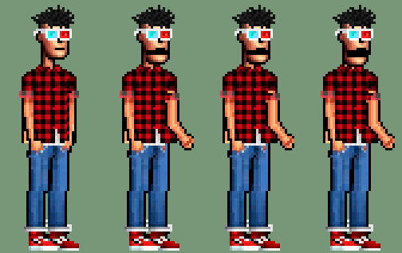
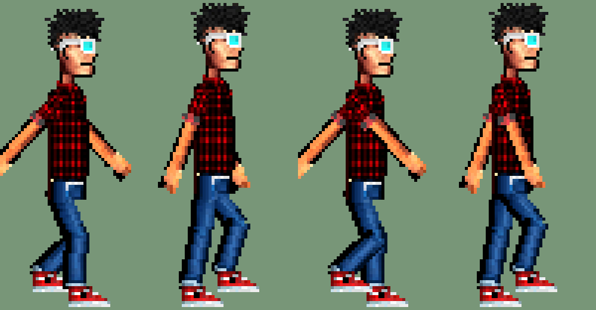

# A2.16 — PRUEBA de estilo «Dex de papel» (`?dex=papel`)

Prueba, no un cambio del juego. Junta tres cosas en Dex buscando la medida justa:

1. el **sprite actual** y las piezas del rig de A2.15 (`art/dex2d/`): el aspecto no cambia;
2. la **manera de moverse de un recortable de papel**: piezas rígidas que pivotan, poses a saltos (pocos
   fotogramas, sin intermedios), rebote;
3. el **habla de recortable**: la mandíbula es una pieza aparte que baja y sube con el volumen de la voz y se
   descoloca un poco (de más, a veces de lado); la parte de arriba de la cabeza no se mueve.

Tono: vendedor entusiasta, con brazos que se disparan a destiempo de la boca. Todas las poses y frases son nuevas
(nada copiado de otros juegos ni de los reels: solo se ha tomado la idea).

## Cómo probarlo

- `/?dex=papel` (intensidad media), `/?dex=papel&papel=suave`, `/?dex=papel&papel=tope`. Vale **también en
  producción** (no hace falta `?qa=1`), igual que `?steps=` (A4.7).
- Sin `?dex=papel` el juego es el de siempre (Dex de A2.15) y los PNG de papel ni se descargan (`PreloadScene`).
- Demo: `BASE_URL=… node scripts/lib/demo.mjs run a2-16-papel` (o `PAPEL=tope` para una sola variante) →
  `demo-out/a2-16-papel/a2-16-papel-{actual,suave,media,tope}.gif`.

## Enfoque

Lo mismo que A2.15: **pre-render a fotogramas** con el rig (a 25×103 px, girar piezas en Phaser emborrona y
«hierve»). `art/dex2d/papel.py` importa `build.py` y genera 40 PNG en `assets/sprites/player/dexpapel/` (137 KB)
y `src/data/dexPapelFrames.ts`. Vecino más cercano; **0 colores fuera de la paleta**; mismos lienzos (37/48 × 103),
mismos pies y ancla.

La **mandíbula** es lo único que se mueve en tiempo real: en los fotogramas de hablar la cabeza va sin las filas de
debajo de la boca (19–22) y el hueco se pinta con el oscuro de la boca; encima, `dexpapel_jaw_{front,r,l}` (10×4 y
8×4 px) como imagen aparte, colocada en píxeles de arte enteros × la escala entera de Dex (sigue nítida). Al bajar
deja ver el oscuro: boca de recortable. La lógica es pura y está en `src/systems/PaperDex.ts`
(`tests/paper-dex.test.mjs`, en `test:engine`); `Player` solo la aplica. `GameScene` le pasa
`VoiceSystem.level()` cuando suena el clip de la frase del jugador (solo en modo papel).

## Números de ritmo

| Qué | Valor | Notas |
|---|---|---|
| Andar de perfil | **4 poses × 150 ms** (ciclo 600 ms = 2 pasos) | paso 74 × 0,6 / 2 = **22,2 px**; pie de apoyo a ±5,55 px de la cadera: entre dos poses la cadera avanza 11,1 px y el pie retrocede 11,1 → **no patina** (test `stanceSlip` ≤ 0,5 px) |
| Andar arriba/abajo | 4 de los 6 fotogramas del rig × 200 ms | mismo ciclo de 800 ms que A2.15 (ahí no hay deslizamiento: solo se levantan los pies) |
| Coger | 3 poses (anticipación, estirón, vuelta) en los 320 ms del gesto (~107 ms) | el pick del rig sin la pose intermedia; por debajo de los 120 ms del encargo para no retrasar el script (A4.1: gesto < 400 ms) |
| Brazos al hablar | pose nueva cada **400–900 ms** (según intensidad), nunca la misma dos veces | reloj propio, a destiempo de la mandíbula; empieza ya gesticulando |
| Mandíbula | escalones de **70 ms**; abre con RMS ≥ 0,02, cierra < 0,01, del todo a 0,15 | sin señal (audio HTML5, sin clip, demo headless): abierta/cerrada en tramos al azar de 70–210 ms |

## Qué hace cada intensidad (un parámetro)

| | suave | media (por defecto) | tope |
|---|---|---|---|
| Andar: rebote de cadera / giro de brazos rígidos / cuerpo adelantado | 0 px / ±18° / 0 | 1 px / ±30° / 1 px | 2 px / ±42° / 1 px |
| Mandíbula: bajada máx. | 2 px | 3 px | 4 px |
| Mandíbula descolocada de lado (1 px) / de más (1 px) | nunca / nunca | 15 % / 10 % | 35 % / 25 % |
| Poses de brazos al hablar | 2 (reposo, mano fuera) | 4 (+ otra mano, «¡tachán!» palmas arriba) | 5 (+ brazo disparado arriba) |
| Cambio de pose | 700–900 ms | 550–850 ms | 400–650 ms |

Poses de hablar: de frente 5 (reposo, mano derecha fuera, mano izquierda fuera con el cuerpo 1 px hacia ese lado,
palmas arriba con los hombros 1 px arriba, brazo disparado arriba con la cabeza 1 px de lado); de perfil 4, todas
con el cuerpo 1 px inclinado hacia quien escucha (mano a la altura del pecho, alta, baja y fuera).

## Qué se ha comprobado

- `python3 art/dex2d/papel.py` → «40 PNG (con 3 mandíbulas) en 9 animaciones; colores fuera de la paleta original: 0».
- `node --experimental-strip-types --test tests/paper-dex.test.mjs tests/player-anim.test.mjs tests/walk-clean.test.mjs`
  (Node 22) → 72 pasan, 0 fallan.
- Simulación local fuera del navegador (`/var/tmp/adv-papel/`, no va al repo): GIF de hablar 7 s con la lógica de
  `PaperDex` y un nivel de voz sintético, y de andar a 74 px/s, en las cuatro variantes lado a lado.

## Límites y qué queda

- La demo en navegador y `tsc`/build no se han podido ejecutar en local (semáforo de trabajo pesado ocupado y sin
  `node_modules` en el worktree): los hace el CI de la PR.
- En headless no hay voz Kokoro para la frase larga: la mandíbula va a cadencia libre (con voz real sigue el nivel).
- Los pasos sonoros (A4.4) siguen con su zancada de 30 px (uno cada ~405 ms); con papel el pie pisa cada 300 ms.
  Si se queda el estilo, habría que pasar la zancada a `Footsteps` según el modo.
- De espaldas no hay mandíbula (no se ve la cara): usa el hablar de A2.15. Las manías de reposo, el shrug y el
  pick de frente son los de A2.15.
- La pose de perfil «mano alta» dobla el codo por delante del pecho: se lee, pero es la más floja.
- El andar es de piernas con rodilla (IK del rig), no el péndulo de piernas juntas: con las piernas rígidas
  inclinadas a la vez el pie patina sí o sí, y el encargo pide no patinar. Lo de papel está en las poses a saltos,
  el rebote, los brazos rígidos y el zapato plano.
