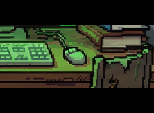
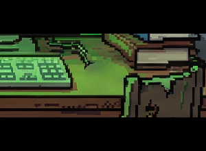
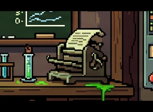
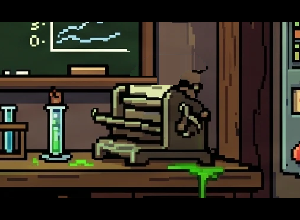
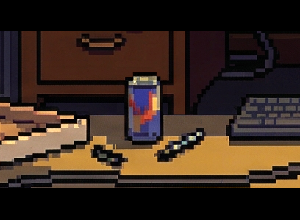
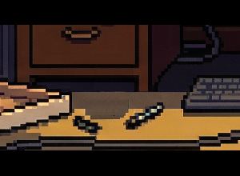
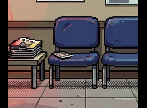
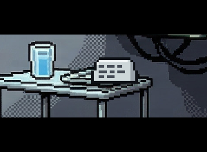
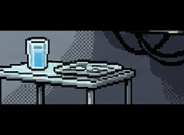

# A3.11 · Lo que ya cogiste desaparece de la escena

**Hueco** (captura de Adrián del 14-nov, `notas/2026-11-14-objeto-cogido-sigue.png`): en el sótano el Old Mouse ya
estaba en el inventario pero seguía dibujado en la mesa y su hotspot seguía activo («Walk to Old Mouse»).

## Qué estaba mal (medido)

1. **El hotspot del ratón no estaba encima del ratón.** `hs_dead_mouse` estaba en x 85–90 % / y 58–70 %, sobre un cable
   que cuelga junto al rack; el ratón dibujado está en la mesa, junto al teclado (x ≈ 62 %, y ≈ 59 %), dentro de
   `hs_left_desk`. Ahora el hotspot está sobre el ratón dibujado (61,6/56,8, 2,4×5,6 %) con `priority: 1` para ganar
   a la mesa, que va antes en la lista.
2. **El nombre al pasar no miraba la visibilidad.** `GameScene` emitía `hotspot:hover` con el nombre de un hotspot
   aunque estuviera oculto (solo el foco miraba `isHotspotVisible`), y un hotspot oculto tapaba al de debajo
   (`getHotspotAtPct` devolvía el primero de la lista y luego se descartaba).
3. **Ningún objeto cogido tenía regla.** De los 26 hotspots con `addItem` de las 13 escenas, ninguno declaraba si
   desaparece o por qué se queda.

## Qué cambia

- **Motor** (`src/systems/HotspotVisibility.ts`, `SceneDataLoader.getHotspotAtPct`, `GameScene`): además de
  `hideWhenFlag`/`showWhenFlag`, un hotspot admite `hideWhen` (gramática `when` de A2.6a: `flag`, `item:x`, `!…`; oculto
  si se cumplen TODAS) y `priority`. El clic, el toque con margen, el nombre al pasar, el resaltado de Tab y
  `__qa.state().hotspots` usan la misma visibilidad; un hotspot oculto no tapa al de debajo. Se evalúa contra el
  estado actual en cada consulta: al volver a la escena o al cargar partida no hay nada que restaurar.
- **Flag «ya cogido»**: se oculta con la flag que pone el PICK y que nunca se borra, así sigue oculto aunque el objeto
  se gaste y salga del inventario. Excepción: la lata de upstairs (`hideWhen: ["has_energy_drink",
  "item:energy_drink"]`): oculta mientras la llevas; si la gastas en el rig, vuelve el hotspot porque hay otra «detrás
  del monitor» (ruta crítica del walkthrough, A3.4d).
- **Parche desde el fondo** (`scripts/make-picked-overlays.mjs`, sharp): máscara de formas sobre el objeto (o los
  píxeles claros de un papel y su contorno), reglas opcionales de copia de filas/columnas del fondo, relleno
  del borde hacia dentro con los colores vecinos del propio `background.webp` (sin sembrar con el contorno oscuro),
  suavizado, cuantización a la paleta del anillo de alrededor, alfa 255 solo en la máscara, fuera lo que queda
  casi igual al fondo (Δ ≤ 12), recorte a su caja, WebP sin pérdida y su entrada en `conditionalOverlays` con la
  misma flag. Registrado en `qa/overlays.lock.json`. Si cambia el fondo: volver a ejecutarlo con `--preview <dir>`,
  mirar la hoja y `node scripts/crop-overlays.mjs --update-lock`.
- **Linter, regla p** (`scripts/lint-scenes.mjs`, ERROR): todo hotspot con `addItem` necesita `hideWhenFlag`/`hideWhen`
  con una flag que pone ese mismo hotspot **y** un overlay con esa flag (o `pickedNotDrawn: "<motivo>"` si el objeto
  no está dibujado aparte), o bien `keepAfterPick: "<motivo>"`. Las flags de `hideWhen` cuentan como lecturas (regla
  a). La regla g respeta `priority`.
- **Excepciones**: `keepAfterPick` en el propio hotspot con el motivo (contenedor, mueble o fuente que se queda; el
  objeto iba dentro y no está dibujado aparte). Los textos hablados no cambian.

## Todos los objetos

Oculto = el hotspot deja de existir con la flag; overlay «parche encima» = se pinta sin el objeto con la flag;
«el objeto es el overlay» = el objeto ya era un overlay que se quita con la flag.

| Escena | Hotspot | Objeto(s) | Trato | Flag | Overlay / motivo de la excepción |
|---|---|---|---|---|---|
| basement | `hs_main_computer` | `printout` | excepción | — | El CRT se queda: la hoja impresa sale de la impresora (no está dibujada) y el disquete vuelve al bolsillo |
| basement | `hs_left_desk` | `scrap_paper`, `floppy_disk` | excepción | — | La mesa se queda: el disquete y el papel estaban debajo de los papeles/en el cajón (no dibujados); el PICK de después lo dice («Nothing left but receipts») |
| basement | `hs_armchair` | `monkey_sticker` | excepción | — | El sillón se queda: la pegatina del mono aparece en el bolsillo al hablarle (secreto), no estaba dibujada |
| basement | `hs_dead_mouse` | `broken_mouse` | oculto | `found_broken_mouse` | `mouse_taken` (parche encima) |
| clinic_exterior | `hs_visitor_box` | `sign_in_sheet` | excepción | — | El buzón de visitas se queda: la hoja estaba dentro (no dibujada); el PICK de después dice «Empty now.» |
| clinic_exterior | `hs_trash_can` | `empty_can`, `clinic_note` | excepción | — | La papelera se queda: la nota y la lata estaban dentro (no dibujadas); el PICK de después lo dice |
| clinic_interior | `hs_reception_desk` | `clinic_sign_in_sheet` | excepción | — | El mostrador se queda: la hoja de registro no está dibujada aparte en el fondo; el PICK de después lo dice («The desk looks underdressed without it») |
| clinic_interior | `hs_clinic_photo` | `clinic_photo` | oculto | `found_clinic_photo` | `no_photo` (parche encima) |
| clinic_interior | `hs_dr_coat` | `dr_satoshi_badge` | excepción | — | La bata se queda (la lleva el Dr. Satoshi): la placa iba en el bolsillo interior |
| lobby | `hs_coat` | `keycard`, `leaky_pen`, `mystery_envelope` | excepción | — | El abrigo de Penny se queda (se puede devolver el sobre): la tarjeta, el boli y el sobre iban en los bolsillos, no dibujados |
| memelab | `hs_pepememe` | `pepememe` | oculto | `found_pepememe` | `pepe_taken` (parche encima) |
| mountain | `hs_spring` | `water_bottle` | excepción | — | El manantial se queda: llenas una botella de agua |
| outside | `hs_porch_light` | `note_half_a` | excepción | — | La lámpara se queda: la media nota estaba dentro; el overlay lamp_empty (flag porch_light_off) ya la pinta apagada y vacía |
| outside | `hs_mailbox` | `vet_bill`, `mystery_envelope` | excepción | — | El buzón se queda: la factura y el sobre estaban dentro; el overlay mailbox_empty (flag found_envelope) ya lo pinta vacío |
| outside | `hs_fence` | `fence_plank` | excepción | — | La valla se queda: solo sale un tablón; los overlays plank_loose/fence_gap (flag has_plank) pintan el hueco |
| recovery_pool | `hs_trash_pile` | `rubber_duck` | excepción | — | El montón de basura se queda: el pato estaba enterrado dentro; el PICK de después lo dice |
| rooftop | `hs_antenna_array` | `antenna` | excepción | — | El conjunto de antenas se queda: solo sale la suelta; el PICK de después lo dice («The array leans a little now») |
| server_room | `hs_server_rack_b` | `burned_chip` | excepción | — | El rack se queda: el chip quemado salía de dentro (no dibujado aparte) |
| server_room | `hs_terminal` | `server_log` | excepción | — | El terminal se queda: el log es una copia impresa de su pantalla |
| server_room | `hs_raised_floor` | `glasses_3d`, `extension_cord` | excepción | — | El suelo técnico se queda: las gafas y el alargador estaban debajo de las baldosas; tiles_open/tile_lifted (flag tiles_opened) pintan el hueco |
| treatment_room | `hs_adrian_note` | `adrian_note` | oculto | `found_adrian_note` | `note_folded` (el objeto es el overlay: se quita) |
| treatment_room | `hs_side_table` | `floppy_disk` | excepción | — | La mesa auxiliar se queda con su vaso: el disquete de repuesto estaba debajo del vaso (no dibujado) y vuelve a salir si pierdes el primero |
| upstairs | `hs_pizza_box` | `pizza_slice` | excepción | — | La caja se queda con el resto de la pizza: solo te llevas una porción |
| upstairs | `hs_energy_drink` | `energy_drink` | oculto | `has_energy_drink + item:energy_drink` | `no_energy_drink` (el objeto es el overlay: se quita) |
| upstairs | `hs_paper_tray` | `receipt` | excepción | — | La bandeja se queda: el recibo iba entre los papeles (no dibujado aparte); el PICK de después lo dice («The tray is just sad printouts now») |
| upstairs | `hs_alphapack` | `ape_costume` | excepción | — | La caja ALPHA PACKS se queda y su LOOK lo dice («Empty now — I already took the ape costume»); el disfraz iba dentro |

Recuento por escena (oculto con overlay / solo hotspot / excepción): basement 1/0/3 · clinic_exterior 0/0/2 ·
clinic_interior 1/0/2 · lobby 0/0/1 · memelab 1/0/0 · mountain 0/0/1 · outside 0/0/3 · recovery_pool 0/0/1 ·
rooftop 0/0/1 · server_room 0/0/3 · treatment_room 1/0/1 · upstairs 1/0/3 · epilogue_outside sin objetos. Total:
5 ocultos con overlay (2 parches nuevos: el ratón del sótano y la hoja del Rare Pepe de memelab; 3 con el overlay que
ya existía), 21 excepciones con motivo, ninguno pendiente.

**La hoja del Rare Pepe (memelab).** Sale de la impresora, delante del encerado, su marco y su repisa y de la pared.
El relleno del borde hacia dentro dejaba un bloque de otro tono y el resplandor del papel que se queda en la ranura,
así que el parche usa reglas por zonas (`fill` en `PATCHES`): el encerado y el marco siguen hacia abajo copiando la
fila de encima de la hoja, la repisa sigue hacia la derecha copiando su columna y la pared sigue hacia abajo. El trozo
de papel que entra en la ranura se queda (la impresora sigue con papel).

## Capturas

Hoja antes/después de los cinco objetos que desaparecen (fondo + overlay, recorte ampliado):
`docs/progreso/A3.11/hoja-antes-despues.png` · DROP (30 días): https://drop.zerothetoken.com/public/share/QzB_KRYX5SvOat7Nw5LnOQ

| Objeto | Antes | Después |
|---|---|---|
| basement · ratón |  |  |
| memelab · Rare Pepe |  |  |
| upstairs · lata |  |  |
| clinic_interior · foto |  |  |
| treatment_room · nota |  |  |

Revisado a ojo, ampliado: el parche del ratón no deja contorno ni sombra marrón; queda el cable, que llega hasta donde
estaba el ratón (el LOOK de después, inalcanzable ya, hablaba de él; su clip no se borra). En el del Pepe, el encerado,
el marco, la repisa y la pared quedan continuos; al ampliar mucho se nota una costura de un tono en la pared justo
encima de donde estaba la hoja y dos píxeles negros del rizo de papel sobre la tapa de la impresora, que a tamaño de
juego (y con el filtro anaglifo de la escena) se leen como su contorno. Los tres overlays que ya
existían no cambian. En las excepciones el antes y el después son el mismo dibujo a propósito (o lo cambian overlays
que ya existían: buzón, lámpara, valla, baldosas).

## Pruebas

- `tests/hotspot-visibility.test.mjs` (en `npm run test:engine`): `hideWhenFlag` sigue oculto aunque el objeto se
  gaste, `hideWhen` con objeto (la lata vuelve), un hotspot oculto no tapa al de debajo, `priority`, y en el sótano
  real el punto del ratón pasa a la mesa al cogerlo.
- `tests/lint-scenes.test.mjs`: regla p en sintético (sin regla, sin overlay, flag que no pone el hotspot,
  `hideWhen`, `keepAfterPick` sin motivo) y en las escenas reales.
- `tests/walkthrough-core.test.mjs`: `expect.hiddenHotspots` / `visibleHotspots` contra `st.hotspots`.
- `qa/walkthrough.json`: tras la mesa del sótano, PICK `hs_dead_mouse` y `expect.hiddenHotspots: ["hs_dead_mouse"]`
  (el ratón se retira al cerrar el capítulo 3, así que el tope de inventario del capítulo 4 no cambia).
- Demo `scripts/demo-a3-11-cogidos.mjs`: coge el ratón, la lata y la foto en 1280×720 y 844×390; comprueba que el
  hotspot desaparece, que al pasar por encima ya no sale su nombre, el overlay, la vuelta a la escena y la recarga.
