# A3.3f — Lo que hace falta para un puzle tiene que VERSE (nido, tablón y auditoría)

**Estado: en PR (#79), pendiente del CI.** Rama `scumm/a3-3f-nido`. Origen: Adrián (12-nov), «no encuentro el nido»,
y el agente jugador (J-9): «la valla casi no se ve y las pistas 1–2 de Anon no llevan a ella».

## Qué se ha hecho

- **Nido de urracas** (`outside/overlay_nest.webp`, `conditionalOverlays.nest`, `flag: nest_down`, `invert: true`):
  cuenco de ramitas en la esquina izquierda de la corona de la chimenea, con el cielo rosa detrás, dos urracas
  (una vigila, otra picotea; blanco y negro con reflejo azul) y un papel de aluminio arrugado. El destello del
  aluminio es un `ambient` `flicker` blanco (`nest_foil_glint`, `when: "!nest_down"`). Al caer el nido
  (`fence_plank` + `hs_chimney`) el overlay y el destello desaparecen: no queda nada arriba.
  Va a la izquierda de la corona porque en vertical (390×844) la derecha queda bajo el botón «Connect».
- **Tablón suelto** (`overlay_plank_loose.webp`, `invert` sobre `has_plank`): hueco oscuro en el tercer tablón de la
  valla y el tablón, más claro que sus vecinos, torcido 24° colgando de un clavo brillante. Tras PULL valla, el
  overlay `fence_gap` (`flag: has_plank`) deja solo el hueco.
- **Hotspots:** `hs_chimney` pasa a `x 41.5 y 0.6 w 5.7 h 33.5` para cubrir el nido; `hs_roof` se acorta a `w 10`
  para no solaparse. `hs_fence` no cambia: el tablón cae dentro (x 0,7–2,9 %, y 59,7–71 %) y la cámara lo enseña
  entero en los dos tamaños de móvil (comprobado en la demo); `tr_mountain` y el `walkTo` de A3.3c no se tocan.
- **Pista 2 de Anon de `p1_nest`** (`assets/journal/chapter-1.json`): «Something long could reach that nest. The fence
  on the far left has a plank hanging by one nail.» (antes «Fences are made of long things.», que no decía dónde).
  La pista 1 («The birds know more than they let on.») ya lleva al nido ahora que las urracas se ven. Texto nuevo
  con voz ⇒ etiqueta `voices` en la PR.
- **Arte por código, 0 $:** `scripts/make-outside-props.mjs` (sharp, determinista: PRNG con semilla fija). Pinta en
  una rejilla de arte y escala con vecino más cercano a 4,5 px de fondo por píxel de arte (el `pixelScale` de
  outside), con la paleta muestreada del fondo (contorno casi negro del ladrillo, madera de la valla, paja cálida del
  atardecer). Recorta cada overlay a su caja (misma cuenta que `scripts/lib/overlay-crop.mjs`) y escribe
  `conditionalOverlays` sin reformatear el scene.json. `--preview <dir>` deja composiciones sobre el fondo.
- **Linter, regla (m) «props de puzle dibujados»** (aviso): un overlay condicional cuya flag no pone ningún script
  (nunca cambia) o cuya caja no toca ningún hotspot (se ve pero no se toca). Hoy: 0 avisos. Pruebas en
  `tests/lint-scenes.test.mjs` (`overlayPropDefects` y la regla en `lintProject`).
- **Demo** `scripts/demo-a3-3f-nido.mjs` (844×390 y 390×844): va a la valla y a la chimenea, comprueba que
  `plank_loose` y `nest` están cargados, visibles, dentro de la cámara y con un tamaño mínimo en pantalla; PULL valla
  y tablón + chimenea; comprueba que desaparecen y que sale `fence_gap`. En local: 0 fallos (en 844×390 el nido mide
  39×25 px y el tablón 18×30 px; en 390×844, 105×68 y 50×79).

## Auditoría de hotspots de puzle (13 escenas)

`scripts/audit-hotspot-art.mjs` saca de `qa/walkthrough.json` (ruta crítica) los hotspots que se tocan con un verbo
de acción (no LOOK/TALK) o con un objeto: **50**. Recorta el fondo (con primer plano y los overlays que se ven al
empezar) alrededor del hotspot, con su rectángulo en cian, al doble del tamaño de un móvil apaisado 844×390 con el
panel de verbos abierto (el fondo se ve a 270 px de alto). «Pantalla» = tamaño del hotspot en ese móvil. Los
recortes están en `docs/progreso/A3.3f/` y la tabla de datos en `docs/progreso/A3.3f/hotspots.json`.

**Resumen: 42 se ven · 8 dudosos · 0 invisibles** (antes de esta PR, el nido y el tablón eran invisibles).

| Escena | Hotspot | Pantalla | Qué se ve | Veredicto | Recorte |
|---|---|---|---|---|---|
| basement | hs_equipment | 73×138 | rack de equipos con LEDs | se ve | 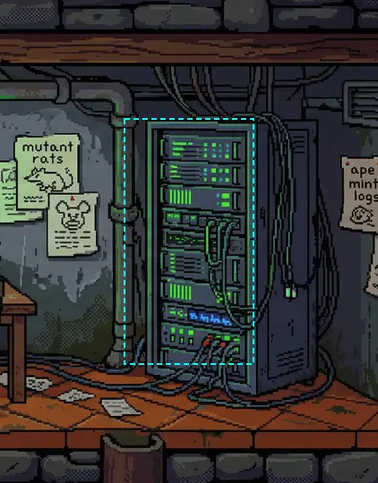 |
| basement | hs_left_desk | 174×38 | mesa con monitor y papeles | se ve | 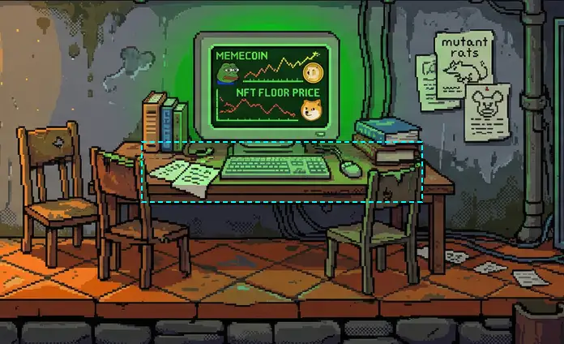 |
| basement | hs_main_computer | 78×45 | monitor verde «MEMECOIN» | se ve | 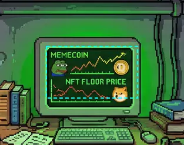 |
| basement | hs_stairs | 62×63 | hueco negro bajo un marco de madera; no se lee «escalera» | dudoso | 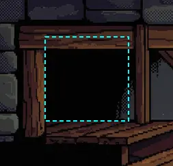 |
| clinic_exterior | hs_main_entrance | 82×101 | puerta doble con letrero y lector rojo | se ve | 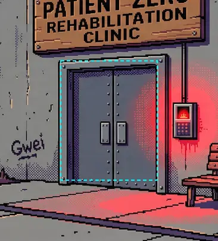 |
| clinic_exterior | hs_trash_can | 30×38 | cubo con ratas | se ve | 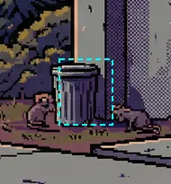 |
| clinic_exterior | hs_visitor_box | 45×41 | buzón de visitas | se ve | 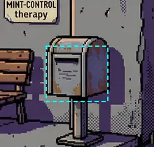 |
| clinic_interior | hs_filing_cabinet | 70×81 | armario «Patient Records» | se ve | 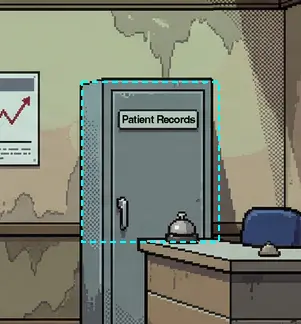 |
| clinic_interior | hs_treatment_door | 71×131 | puerta «Treatment Room» | se ve | 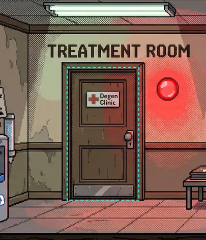 |
| epilogue_outside | hs_now_hiring_sign | 40×16 | cartel «NOW HIRING» | se ve |  |
| epilogue_outside | hs_path_forward | 124×17 | franja oscura en la esquina de abajo; el camino se ve más arriba, fuera del hotspot | dudoso | 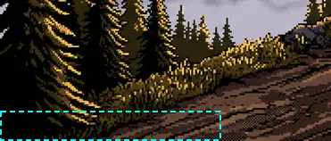 |
| lobby | hs_coat | 42×98 | abrigo en la percha «COATS» | se ve | 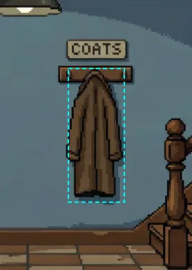 |
| lobby | hs_frontdoor | 54×184 | puerta | se ve | 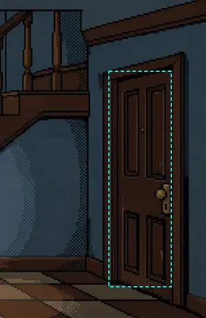 |
| lobby | hs_monitor_desk | 287×113 | mostrador con monitores | se ve | 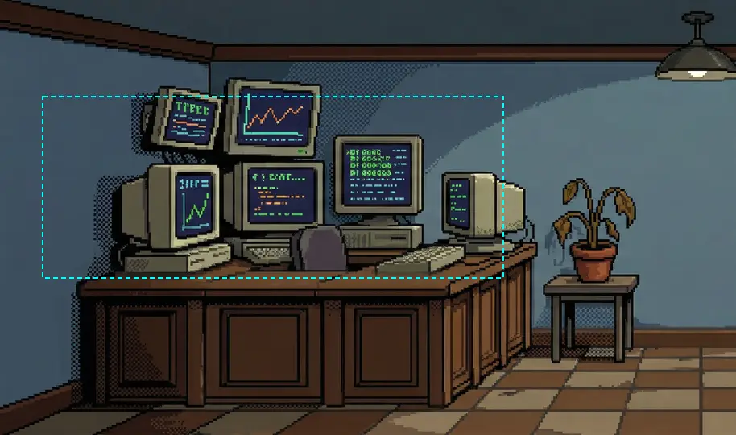 |
| lobby | hs_plant | 44×54 | planta mustia en maceta | se ve | 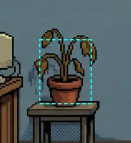 |
| lobby | hs_poster | 38×55 | pared lisa en el fondo; el póster lo pinta el sprite `web3Visuals.vip_poster` (no sale en el recorte) | se ve (en juego) | 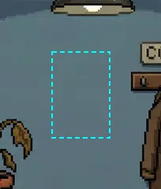 |
| lobby | hs_stairs_up | 171×90 | escalera con barandilla | se ve | 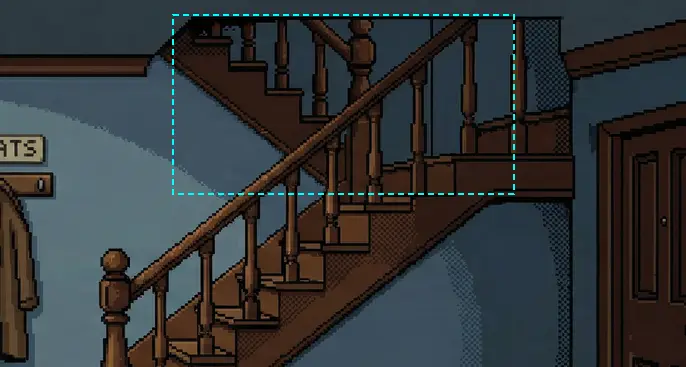 |
| memelab | hs_exit_door | 47×164 | puerta oscura entre limo verde | se ve | 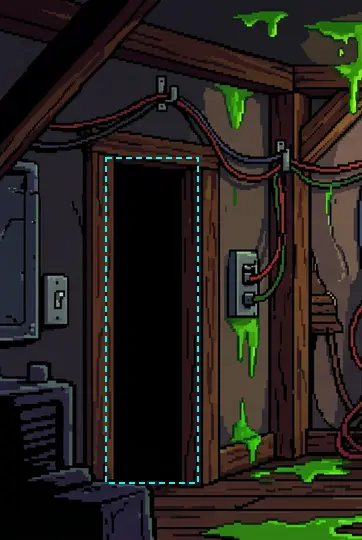 |
| memelab | hs_meme_tube | 104×186 | tubo verde brillante | se ve | 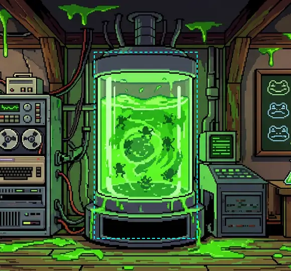 |
| memelab | hs_pepememe | 49×38 | máquina con papel en la mesa | se ve | 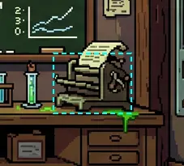 |
| mountain | hs_winding_path | 88×101 | sendero que sube | se ve | 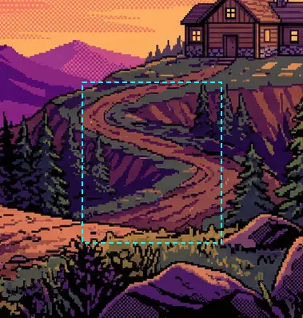 |
| outside | hs_chimney | 50×90 | **chimenea con nido y dos urracas (A3.3f)** | se ve | 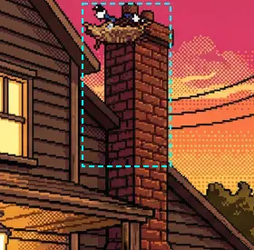 |
| outside | hs_doormat | 67×14 | felpudo oscuro sobre el porche oscuro, poco contraste | dudoso | 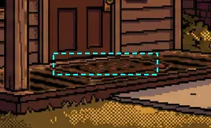 |
| outside | hs_fence | 44×81 | **tablón claro torcido colgando de un clavo (A3.3f)** | se ve | 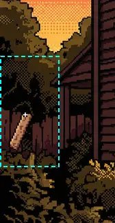 |
| outside | hs_front_door | 44×71 | puerta | se ve | 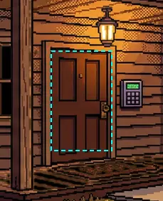 |
| outside | hs_keypad | 17×24 | teclado con pantalla verde (pequeño pero brillante) | se ve | 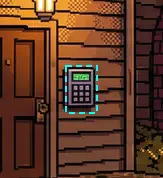 |
| outside | hs_mailbox | 32×30 | buzón con bandera roja | se ve | 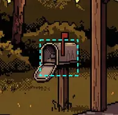 |
| outside | hs_porch_light | 26×22 | farol encendido | se ve | 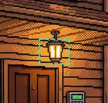 |
| recovery_pool | hs_brown_book | 30×22 | libro marrón al borde de la piscina | se ve |  |
| recovery_pool | hs_dark_door | 40×148 | hueco negro pegado al borde izquierdo, medio cortado | dudoso | 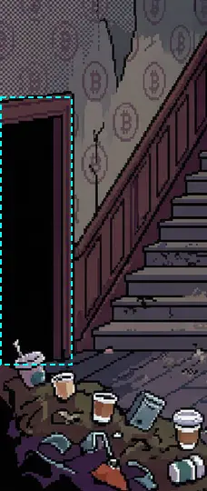 |
| recovery_pool | hs_rubber_duck | 52×41 | flotador de pato amarillo | se ve |  |
| recovery_pool | hs_stairs_up | 97×149 | escalera | se ve | 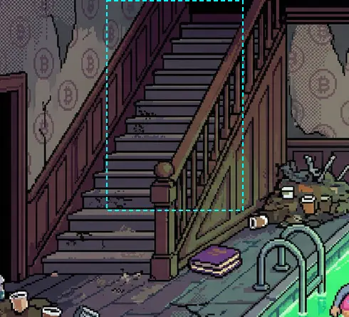 |
| recovery_pool | hs_trash_pile | 104×54 | montón de vasos y basura | se ve | 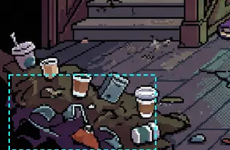 |
| rooftop | hs_antenna_array | 73×108 | antena de varillas | se ve | 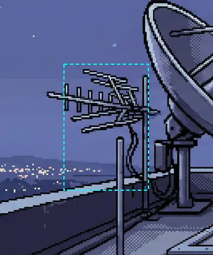 |
| rooftop | hs_roof_access_panel | 122×32 | trampilla en el suelo, gris sobre gris | dudoso | 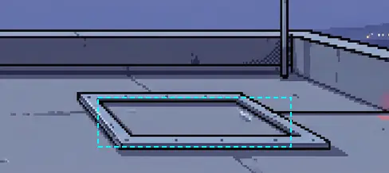 |
| rooftop | hs_satellite_dish | 131×119 | parabólica | se ve | 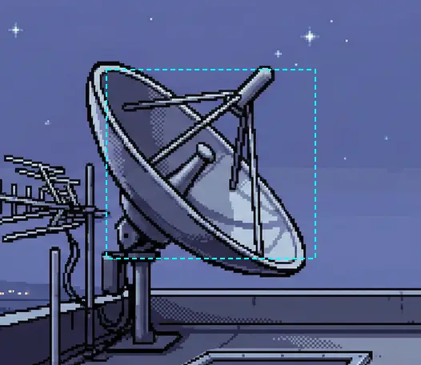 |
| rooftop | hs_weather_vane | 87×121 | veleta con ₿ | se ve | 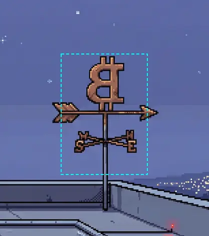 |
| server_room | hs_emergency_switch | 57×87 | interruptor rojo «EMERGENCY SHUTOFF» | se ve | 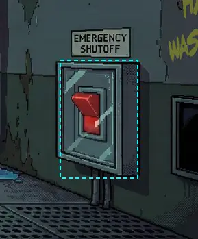 |
| server_room | hs_raised_floor | 338×33 | franja del suelo técnico; una baldosa levantada muy sutil a la izquierda | dudoso | 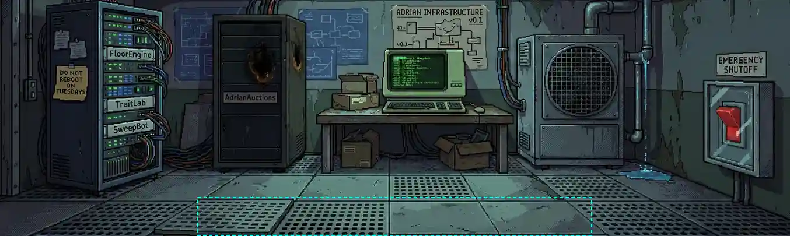 |
| server_room | hs_server_rack_b | 77×130 | rack quemado «AdrianAuctions» | se ve | 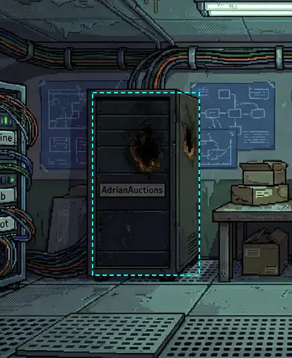 |
| server_room | hs_terminal | 75×49 | terminal verde | se ve | 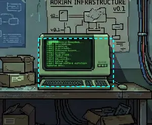 |
| treatment_room | hs_adrian_note | 42×15 | papeles en la mesita, pequeños | dudoso | 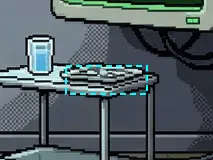 |
| treatment_room | hs_chair | 141×88 | sillón de tratamiento | se ve | 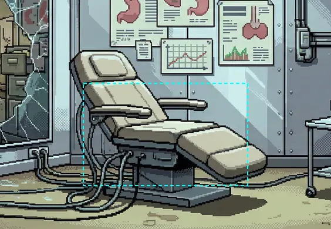 |
| treatment_room | hs_exit_door | 68×177 | puerta con ojo de buey | se ve | 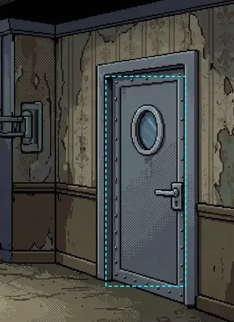 |
| treatment_room | hs_monitor | 81×68 | monitor «PATIENT ZERO» | se ve | 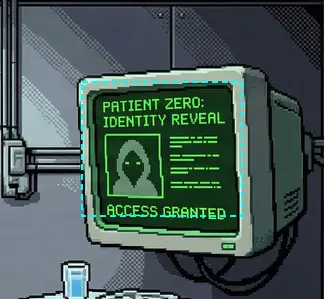 |
| upstairs | hs_computer | 104×121 | rig de minería con luces verdes | se ve | 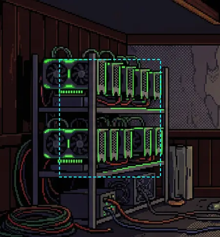 |
| upstairs | hs_desk | 182×42 | escritorio con tres monitores | se ve | 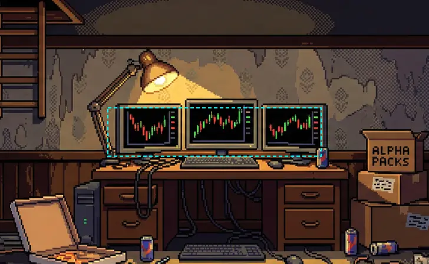 |
| upstairs | hs_energy_drink | 26×25 | lata de bebida energética (pequeña) | se ve | 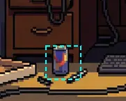 |
| upstairs | hs_pizza_box | 70×22 | caja de pizza abierta | se ve | 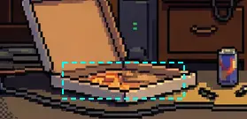 |
| upstairs | hs_roof_hatch | 129×35 | escotilla en el techo con escalera de mano | dudoso | 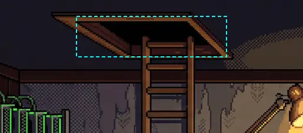 |

### Propuestas para los dudosos (las decide el orquestador; no van en esta PR)

1. **outside/hs_doormat** (PICK, tablón → felpudo; ruta crítica del ledger): borde claro o esquina levantada del
   felpudo con un overlay `invert` sobre `found_ledger`, mismo script (`make-outside-props.mjs`).
2. **server_room/hs_raised_floor** (PICK): acentuar la baldosa levantada (sombra negra debajo, borde claro) con un
   overlay `invert` sobre la flag que abre `tiles_open`; o estrechar el hotspot a esa baldosa.
3. **rooftop/hs_roof_access_panel** (USE con keycard/terminal_key): remaches y una tira amarilla de peligro o un LED
   del lector de tarjeta (ambient `leds`).
4. **upstairs/hs_roof_hatch** (USE): la escotilla está, pero en sombra; un `glow` tenue bajo la escotilla o un rayo de
   luz por la rendija.
5. **treatment_room/hs_adrian_note** (PICK): nota más grande y clara (papel blanco doblado) como overlay `invert`.
6. **epilogue_outside/hs_path_forward** (USE): subir el hotspot a donde se ve el camino, o flecha/luz al final.
7. **basement/hs_stairs** y **recovery_pool/hs_dark_door** (USE, salidas): un par de peldaños con luz en el hueco;
   para la puerta pegada al borde, comprobar que la cámara la enseña entera o moverla dentro.
8. **Herramienta:** el recorte de `lobby/hs_poster` no muestra el póster porque es un sprite de `web3Visuals`; si se
   repite la auditoría, componer también esos sprites.

## Cómo repetir

```
node scripts/make-outside-props.mjs --preview /var/tmp/adv-a33f/pv   # regenera los 3 overlays y su caja
node scripts/crop-overlays.mjs --check                               # el lint los da por buenos
node scripts/audit-hotspot-art.mjs                                   # recortes + hotspots.json
BASE_URL=http://127.0.0.1:4173 node scripts/lib/demo.mjs run a3-3f-nido
```
