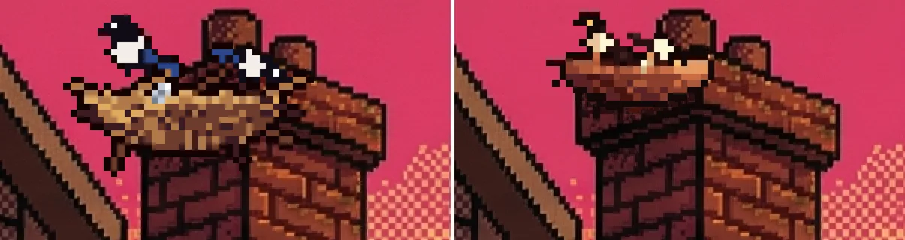

# A3.3h — El nido de urracas, pintado en el fondo (no pegado)

**Estado: en PR.** Rama `scumm/a3-3h-nido`. Origen: Adrián (13-nov), retoque del nido de A3.3f (PR #79): que el humo
o las nubes de la chimenea pasen por delante, que sea más pequeño y que parezca parte del fondo.



## Qué cambió

- **Profundidad.** El fondo de `outside` no pinta humo en la chimenea: lo que pasa por ahí son las nubes del cielo, el
  ambient `sky_clouds` (`clouds`, depth 1 por defecto de su tipo; el fondo va en -1). El nido iba en depth 5 (como
  todos los overlays de `outside`), por encima de las nubes. Ahora `conditionalOverlays.nest.depth = 0`: entre el
  fondo (-1) y las nubes (1), que pasan POR DELANTE. Es declarativo (el campo `depth` del overlay ya existía y
  `GameScene` lo usa); lo escribe `make-outside-props.mjs` (campo `depth` opcional por overlay; los demás siguen en 5).
  El destello del aluminio (`nest_foil_glint`, `flicker`, por defecto depth 5) pasa también a `depth: 0`, para que la
  nube lo tape igual que al nido.
- **Tamaño.** Caja del overlay de 171×112 px de fondo a **131×82** (77 % de ancho, 73 % de alto). En pantalla
  (demo): 844×390 de 39×25 a **30×19 px**; 390×844 de 105×68 a **80×50 px**. Cuenco de 28 a 21 píxeles de arte,
  urracas de 12 a 9. Se mantiene en la parte izquierda de la corona (en vertical la derecha la tapa «Connect»).
- **Paleta.** Solo colores del fondo: k-means de 20 colores del recorte de la chimenea (1540–1800 × 0–300) para el
  nido, el contorno (18,7,7), las sombras y las urracas, y los dos cremas más claros del fondo entero
  (252,246,212 y 232,197,157) para el blanco de las urracas y el aluminio. Fuera el blanco puro, el azul de la cola
  (que el fondo no tiene; ahora ciruela 65,30,31) y el amarillo plano.
- **Luz.** Rampa de 7 tonos de la sombra (izquierda, hacia la casa) a la luz (derecha, hacia el sol, como la cara
  iluminada de la chimenea), borde de arriba más claro y panza más oscura, con tramado en damero como el del cielo
  y el ladrillo. Hueco del cuenco oscuro. El blanco de cada urraca es crema claro del lado del sol y crema oscuro del
  otro.
- **Contorno.** 1 píxel de arte (4,5 px de fondo) del negro del ladrillo, como el del fondo; las ramitas sueltas van
  en línea de 1 px sin contorno (no puntos sueltos).
- **Sombra de contacto.** Bajo el cuenco, el ladrillo de la corona se oscurece (fondo × 0,55 y × 0,72 en damero en la
  fila de abajo, cuantizado a la paleta); no se pinta sobre el cielo.
- **Sin halo.** El juego dibuja los overlays con filtro lineal (A2.8); el borde transparente mezclaba el arte con
  transparente. Ahora el overlay lleva una orla de 3 px con los píxeles del fondo tal cual: el filtro mezcla el borde
  con lo mismo que hay detrás.
- **Aluminio.** 2×2 píxeles crema en el borde del cuenco, sin blanco puro; el destello `nest_foil_glint` baja de
  alfa 0,95 a 0,5 (color #fff6d4, área 0,35×1,1 %).
- **Hotspot.** `hs_chimney` de `x 41.5 y 0.6 w 5.7 h 33.5` a `x 41.9 y 0.2 w 5.3 h 33.9` (cubre el nido nuevo,
  1556–1687 × 3–85 px, y la chimenea; mismo borde de abajo). Regla (m): 0 avisos.
- **Demo `a3-3f-nido`:** tamaño mínimo del nido de 20 a 15 px y nueva comprobación de que el depth del nido es menor
  que el de `sky_clouds`.
- El tablón de la valla no se toca (sus WebP salen idénticos).

Capturas: [844×390](A3.3h/land-844x390.webp) · [390×844](A3.3h/port-390x844.webp).

## Cómo repetir

```
node scripts/make-outside-props.mjs --preview /var/tmp/adv-a33h/pv
node scripts/crop-overlays.mjs --check
BASE_URL=http://127.0.0.1:4173 node scripts/lib/demo.mjs run a3-3f-nido
```
